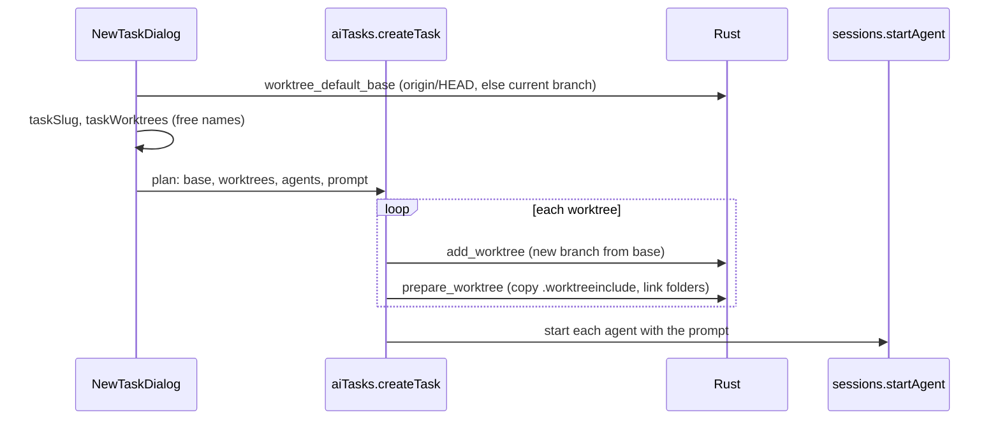

# How AI Tasks Work

New Task makes one worktree per agent from the repository's default branch, gets each one ready to run and starts its agent with a first prompt; Finish Task removes a worktree and its branch. The user side is [AI Tasks](../usage/AI-Tasks.md); the panel around it is [How the AI Panel Works](How-the-AI-Panel-Works.md).

## Why we need it

Agents work best in parallel: every task in its own git worktree, often several agents racing on the same task. Our New Worktree dialog could already make a worktree, but a task needed four fields, a fresh checkout lacked `.env` and `node_modules`, and cleaning up took two steps.

## How it works

### Names

`taskModel.ts`: `taskSlug` turns the task into a branch name (accents dropped, anything else a hyphen, at most 60 characters). `taskWorktrees` gives each raced agent `slug`, `slug-2`... with a folder next to the main checkout (`defaultWorktreePath`), skipping names a local branch or worktree already uses. The dialog therefore only checks the branch name's form; a taken name moves on to the next free one, and the dialog says so.

### The default base

`worktree_default_base` (`git/worktree_prepare.rs`) reads `refs/remotes/origin/HEAD`; when its target exists, the task starts from it (`origin/main`). Otherwise from the current branch, else `HEAD`.

### Ready to run

`prepare_worktree(mainRoot, worktreePath, linkDirs)`:

- reads `.worktreeinclude` in the main checkout and copies each literal path (files and folders, links kept as links);
- links each of `linkDirs` (`aiWorktreeLinks`, default `node_modules`) as a symlink to the main checkout's folder;
- touches only paths git ignores (`is_path_ignored`, also with a trailing slash for folders), never overwrites, and refuses patterns, absolute paths and `..`;
- adds `/<folder>` for each link to the shared `.git/info/exclude`, because git sees a link as a file and a `node_modules/` rule does not match it.

It returns copied, linked and skipped paths with reasons; `prepareSummary` turns them into the toast.

### First prompt

`promptArguments` (`agents.ts`) knows how each agent takes a prompt: Claude Code, Codex and Cursor take it as their last argument, OpenCode after `--prompt`, Gemini after `--prompt-interactive`, Copilot after `-i`. Aider, Amp and Qwen Code get it typed: the agent tab stores it as `pendingPrompt`, and `TerminalView.typeWhenQuiet` types it once the agent's start-up output has been quiet for 0.9 s (at most 20 s), then Enter.

### Finish Task

`finishTask` closes the worktree's agent tabs, removes the worktree (forced only when the user agreed to lose changes; when git still finds untracked files it asks before forcing) and deletes the branch with `-d`. When git answers "not fully merged", it asks before `-D`.

## Where the code lives

| File | What it does |
| --- | --- |
| `src/lib/ai/NewTaskDialog.svelte` | The dialog |
| `src/lib/ai/taskModel.ts` | Branch names and worktree folders |
| `src/lib/ai/aiTasks.ts` | `createTask`, `finishTask`, `prepareSummary` |
| `src-tauri/src/git/worktree_prepare.rs` | `default_base`, `prepare` |
| `src-tauri/src/commands/worktree.rs` | `worktree_default_base`, `prepare_worktree` |

## Design decisions

**Worktrees one after another.** Creating them in turn keeps git's lock files out of each other's way, and a failure names the worktree it stopped at; the ones made before it stay.

**Links, not copies, for big folders.** `node_modules` can be gigabytes; a link costs nothing. Copies are for small files a task may change, like `.env`.

**Only ignored paths.** Anything git tracks is already in the checkout; copying it would hide real changes.

## Tests

- `taskModel.test.ts`: names, taken names, the race limit.
- `agents.test.ts`: prompt arguments per agent; `aiTasks.test.ts`: the summary.
- Rust `worktree_prepare` tests: the default base with and without a remote, copying, linking, skipping (tracked, missing, patterns, outside), never overwriting, and a linked folder that leaves the worktree clean and removable without touching the main checkout's folder.
- Checked end to end in the app: a race of two from `main`, `.env` copied, `node_modules` linked, the prompt passed, then Finish Task removing a worktree and its branch.

## Keeping this page in sync

- A new agent needs its prompt mode in `agents.ts`.
- Retake `ai-new-task.png` when the dialog changes.
