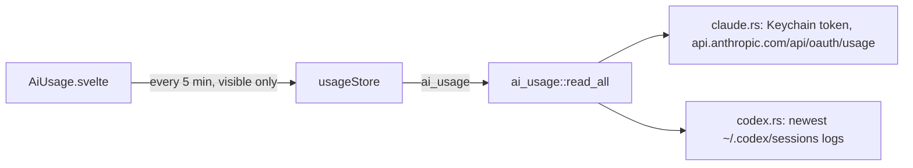

# How AI Usage Works

The status bar shows Claude Code's and Codex's rate-limit usage. The user side is [AI Usage](../usage/AI-Usage.md); the agents themselves are in [How the AI Panel Works](How-the-AI-Panel-Works.md).

## Why we need it

Agents stop when a plan's 5-hour or weekly limit runs out, often in the middle of a task. People who run several agents at once watch it closely, so it belongs in the status bar.

## How it works

`ai_usage::read_all` looks for agents where they keep their files, using HOME, `CLAUDE_CONFIG_DIR` and `CODEX_HOME` from the login shell's environment (what the agents themselves see), and returns one `ProviderUsage` per agent found: status (`ok`, `signedOut`, `noData`, `error`), the session and weekly windows (`usedPercent`, `windowMinutes`, `resetsAt`), the plan and a message.

### Claude Code

`claude.rs` reads Claude Code's credentials JSON from the Keychain item `Claude Code-credentials` (account: the login user) through the `keyring` crate, or from `.credentials.json` on other systems. It sends `GET https://api.anthropic.com/api/oauth/usage` with the access token and `anthropic-beta: oauth-2025-04-20`, as Claude Code does, and reads `five_hour` and `seven_day` (`utilization`, `resets_at`), plus single models' weekly limits such as Fable (`model_weekly`): the `limits` list's `weekly_scoped` entries (`percent`, `scope.model.display_name`), else the older `fable_weekly`, `fable_seven_day` or `seven_day_fable`. An expired token is not sent; 401 or 403 reads as signed out; 429 as "asked to wait". The token is read for each request and never kept. When the Keychain refuses, a flag stops further questions until the user's Refresh (`fresh`).

### Codex

`codex.rs` reads the newest session logs (up to 12, their last 4 MB) for the last `token_count` event's `rate_limits` (`primary`, `secondary`: `used_percent`, `window_minutes`, `resets_at` or `resets_in_seconds`). Windows up to a day are the session window, longer ones the week. A window whose reset has passed reads 0%.

### Times

`time.rs` parses ISO 8601 (with offsets and fractions) and epoch seconds or milliseconds without a date library.

### The status bar

`usageStore` polls only while a status bar shows the usage and the window is visible, reads again 15 s after an agent finishes or starts waiting (at most once a minute) and on Refresh. `usageView.ts` writes "42% 2h 15m · 83% 2d 4h" (each window's use and the time left until its reset, counting down every 30 s; a single model's window keeps its name, a window without a reset time shows its length), picks the fuller window for the bar, colors from 80% and 95%, and the reset countdowns. `settings.aiUsagePosition` puts `AiUsage` on the left, the right or nowhere; `settings.aiUsageHidden` lists providers left out, which `read_all` skips entirely (no Keychain, network or files) and the status bar filters at once (`usageStore.shown`).

## Where the code lives

| File | What it does |
| --- | --- |
| `src-tauri/src/ai_usage/` | `mod.rs`, `claude.rs`, `codex.rs`, `time.rs` |
| `src-tauri/src/commands/ai.rs` | `ai_usage` |
| `src/lib/ai/usageStore.svelte.ts`, `usageView.ts`, `AiUsage.svelte` | Polling, text and the status bar part |

## Design decisions

**The agent's own sign-in, never our own copy.** Reading the token at each request means nothing new is stored and a re-login in Claude Code just works.

**Codex from its files.** Codex records its limits after each answer, so no token or network is needed.

**Slow polling.** Anthropic refuses frequent requests, and the numbers change slowly.

## Tests

- Rust: credentials parsing; the request's address and headers; both windows; signed out, expired (not sent), 401, 429, unreadable answers and offline; Codex's last record, window sorting, both reset forms, a passed reset, the newest log with numbers; ISO and epoch times.
- `usageView.test.ts`: the text, window names, levels, countdowns, lines and plan titles.
- Screenshots use sample numbers answered by the page (`cannedAiUsage`), never a real sign-in.

## Keeping this page in sync

- If Anthropic's or Codex's fields change, update the readers and their tests.
- Retake `ai-usage.png` when the look changes.
