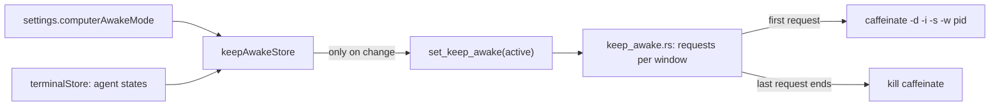

# How Keep Computer Awake Works

Keep computer awake holds the display and the system awake while the mode is On, or while an agent works in Agent mode. The user side is [Keep Computer Awake](../usage/Keep-Computer-Awake.md).

## Why we need it

An agent can work for an hour. If the Mac's screen turns off, locks or the Mac sleeps meanwhile, the run stalls. On, Agent and Off cover the cases: always, only while agents work, or never.

## How it works

### When to hold it

`keepAwakeModel.wantsAwake(mode, states)`: always in On, never in Off, and in Agent while any agent is starting or working (not waiting for the user, done or exited). `keepAwakeStore` runs in every app window (started from `App.svelte`), follows the mode and its window's agents, and calls `set_keep_awake` only when the answer changes.

### Holding it

`keep_awake.rs` counts which windows ask (`Requests`): the first one starts a guard, the last one to stop ends it, and a closed window's request is released (`release_window`).

- **macOS:** `/usr/bin/caffeinate -d -i -s -w <app pid>`. `-d` keeps the display on (so it does not lock from idle), `-i` stops idle sleep, `-s` stops system sleep on power, and `-w` ends caffeinate when the app ends, even after a crash. A caffeinate killed from outside is started again on the next change.
- **Windows:** `SetThreadExecutionState(ES_CONTINUOUS | ES_SYSTEM_REQUIRED | ES_DISPLAY_REQUIRED)` on a thread of its own, reset when the guard drops.
- **Linux:** `systemd-inhibit --what=idle:sleep ... sleep infinity`.

### The status bar

`KeepAwake.svelte` draws the control: a coffee cup, the mode and a dot filled while the computer is held awake; its menu has the title and status ("Agent · Active") and the three modes with what each does. Settings > AI has the same choice.

## Where the code lives

| File | What it does |
| --- | --- |
| `src-tauri/src/keep_awake.rs` | Requests per window and the guard per system |
| `src-tauri/src/commands/ai.rs` | `set_keep_awake` |
| `src/lib/ai/keepAwakeModel.ts` | When to hold it, the words |
| `src/lib/ai/keepAwakeStore.svelte.ts`, `KeepAwake.svelte` | Following the agents, the status bar control |

## Design decisions

**One caffeinate with `-w`.** It cannot outlive the app, so the Mac never stays awake by mistake.

**Display too.** Without keeping the display awake, the screen locks and some setups sleep anyway.

**Waiting does not count.** An agent waiting for an answer is not working; holding the computer awake for it would keep it awake all night.

## Tests

- Rust: requests start and stop the guard at the first and last window; on macOS, caffeinate runs while asked and is gone after.
- `keepAwakeModel.test.ts`: the three modes and agent states, the words, the lid notes.
- Checked in the app with a stand-in agent: no caffeinate when idle, one while the agent worked, none once it finished.

## Keeping this page in sync

- Retake `keep-awake.png` when the control changes.
