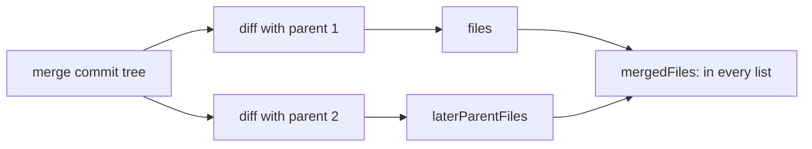

# How merge commits work

A merge commit has two or more parents. This page explains how the Log's commit details list a merge's files: the files that differ from every parent by default, or the changes to each parent. For the user side, see [Merge Commits](../usage/Merge-Commits.md).

## Why we need it

The Log used to diff every commit against its first parent only. For a merge that shows everything the merged branch brought in, which can be dozens of files, and hides the question people usually ask: which files did the merge have to combine, and how were the conflicts resolved? PhpStorm answers this with "merged conflicts", and people comparing the two apps saw different lists for the same commit. Now both show the same files.

## How it works

`log::details` (`src-tauri/src/git/log.rs`) diffs the commit's tree against each parent's tree with git2, with rename detection. `git/commit_files.rs` holds the pieces:

- `changed_files(repo, parent, tree)`: the `ChangedFile` list against one parent (none for a root commit).
- `merged_files(first, later)`: the files of the first list whose path is also in every later list. A file is in it only when the merge result differs from all parents, the same rule as `git diff-tree -c --name-only`.

`CommitDetails` carries `files` (against parent 1, as before), `laterParentFiles` (one list per later parent, empty for a normal commit) and `mergedFiles`.

On the page, `src/lib/log/commitFiles.ts` turns the details into rows. `commitFileRows(details, view)` gives a normal commit's files; for a merge it gives `mergedFiles` in the `merged` view, or a heading per parent followed by that parent's files in the `parents` view. Each file row carries its `parentIndex`. Its key is the path for parent 1 and `index + NUL + path` for later parents, so the same file under two parents stays two rows, and switching views keeps a parent 1 selection.

`CommitLoader` (`commitLoader.svelte.ts`) keeps `mergeView`, the `selectedKey` and the derived `rows`. `loadDiff` calls `getCommitFileDiff(..., parentIndex)`, which reaches `diff::commit_file` with that parent. The diff's left label comes from `parentLabel`: **Parent**, or **Parent 2** for a merge's second. The binary preview of a later parent uses that parent's full id, which the `gmpreview` scheme accepts.

`CommitFileList.svelte` draws the caption (with **Show parents** or **Show both sides**), the list and the empty state with **Show changes to parents**.

## Where the code lives

| File | What it does |
| --- | --- |
| `src-tauri/src/git/commit_files.rs` | `ChangedFile`, `changed_files`, `merged_files` |
| `src-tauri/src/git/log.rs` | `details`: the lists for every parent |
| `src-tauri/src/git/diff.rs` | `commit_file` with a parent index |
| `src/lib/log/commitFiles.ts` | Rows, keys, selection and captions |
| `src/lib/log/commitLoader.svelte.ts` | Selection, view and the diff against the chosen parent |
| `src/lib/log/CommitFileList.svelte` | The list, its caption and empty state |

## Design decisions

- **Files that differ from every parent, not "conflicts".** Git keeps no record of conflicts, so no tool can list them exactly. The rule matches git's combined diff and PhpStorm, and the UI says "Changed on both sides" because a file both branches changed in different places is listed too.
- **The merged view is the default for merges.** It answers the common question and is short; the per-parent view is one click away.
- **Every list is sent at once.** A merge's lists come in one call so switching views needs no round trip. Each list is a tree diff git2 does quickly; a normal commit sends empty extra lists.
- **Parent 1 for a merged file's diff.** It shows what the other branch and the resolution brought in. The per-parent view gives the diff against parent 2.

## Tests

- `src-tauri/src/git/commit_files_tests.rs`: a merge where both sides changed one file, a resolved conflict, a merge that took each file from one side (no merged files), normal and root commits, and `commit_file` against parent 1, parent 2 and a missing parent.
- `src/lib/log/commitFiles.test.ts`: rows in both views, keys per parent, picking the selection, labels and captions.

## Keeping this page in sync

- A change to how `CommitDetails` lists files updates `commitFiles.ts` and both test files.
- Retake `merge-commit-files.png` when the merge view looks different.
