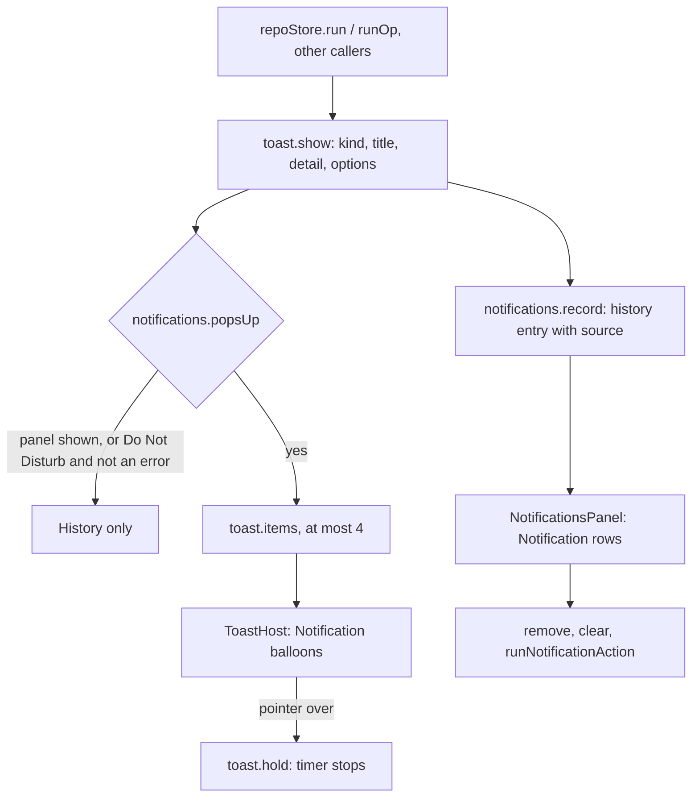

# How notifications work

Every message the app shows (a push, a failed pull, an Undo after a discard) goes through one toast store. The store pops it up as a balloon and records it in a history that the Notifications panel lists. The look follows the JetBrains IDEs: balloons in the bottom right corner and a Notifications tool window on the right.

## Why we need it

A message that pops up and fades is easy to miss, especially git's error text after a failed pull. In a workspace with many repositories, a bare "Pushed" also does not say where. The old toasts had a colored edge and a button, and the history lived in a small popup on the status bar. Users asked for the IDE layout: readable balloons, and a panel in the right sidebar where every event stays until it is cleared.

## How it works

1. A caller says what happened: `toast.success(title, detail, source)`, or `toast.show(kind, title, detail, { timeoutMs, action, source })`. `repoStore.run` and `runOp` pass `notificationSource(repoPath)`, the repository's name. Git operations write their text with `gitReport.ts` (see below).
2. The store records every message in the history first (`notifications.record`), so Do Not Disturb never loses one.
3. `shouldPopUp` decides whether a balloon shows. It says no while the Notifications panel is shown, since the message is already in view (the IDE does the same). With Do Not Disturb on, it lets only errors through.
4. A balloon closes after its timeout: 9 s for errors, 6 s for warnings, 8 s with a link, 3.5 s otherwise. `ToastHost` calls `onhold` when the pointer or the focus enters a balloon, which stops the timer. Leaving starts a 2.5 s timer. With more than `MAX_TOASTS` (4) balloons up, the oldest close early.
5. The panel draws `notifications.items` as rows. `editorSettingsSync` keeps `notifications.open` equal to "the right sidebar shows the Notifications panel". Opening it marks everything read, and the ids that were unread go into `notifications.fresh`, which the rows show as a dot until the panel closes. Messages that arrive while it is open are read at once and join `fresh`.

The bells in the right activity bar and the status bar both call `settings.toggleRightPanel("notifications")`, and so does View > Notifications. They count unread errors and warnings (`unreadAlerts`), and turn red when one is an error (`hasUnreadError`).

### What git messages say

A list of messages that all read "Pushed" or "Pulled" says nothing, so `src/lib/notifications/gitReport.ts` words each git operation from the branch state before it and git's own output:

- `refUpdates` reads the `<flag> 
 <from> -> <to>` lines that fetch and push print (`  a..b main -> origin/main`, `* [new branch]`, `- [deleted]`, `+` forced, `!` rejected).
- `outputSummary` turns the output into one fact per line: those refs (at most 6, then "and N more"), `Updating a..b`, Fast-forward, a merge commit, Rebased, the files-changed line, a new commit (`[main 74dae5f] subject`) and the new upstream. Progress lines that end in a carriage return are dropped.
- `fetchReport`, `pullReport`, `pushReport`, `pushTagsReport`, `syncReport`, `commitReport` and `operationReport` build the title from the `HeadInfo` copied before the work (`headOf` in `gitActions.ts`): the branch, its upstream and how many commits it was ahead. "Already up to date" and "Everything up-to-date" become an info message instead of a success.

`runOp` takes either a fixed title, which gets `outputSummary` as its detail, or a function from the `OpOutcome` to a report. `run`'s `success` may return a report too, and both take a `failure` title such as "Could not push main".

## Where the code lives

- `ui/web/src/lib/components/Notification.svelte`: one message, as a `balloon` (a toast) or a `row` (the list). It has the kind's icon, title, source, time, detail, action link and close button.
- `ui/web/src/lib/components/ToastHost.svelte`: the fixed stack of balloons. It sits above the status bar and beside the right activity bar (`--toast-offset-right`, `--toast-offset-bottom`).
- `ui/web/src/lib/logic/toastModel.ts`: kinds, timeouts, `kindIcon`, `kindTone`, `kindLabel`.
- `ui/web/src/lib/icons.ts`: the `info`, `circle-check` and `circle-alert` icons.
- `ui/design-tokens/components-2.json` (`notification`) and `components.json` (`toast`): sizes.
- `src/lib/ui/toast.svelte.ts`: the app's toast store: options, timers, hold, the cap.
- `src/lib/notifications/gitReport.ts`: the titles and details of git operations.
- `src/lib/notifications/notificationModel.ts`: pure list operations such as `addNotification`, `removeNotification`, `shouldPopUp`, `unreadAlerts` and `hasUnreadError`.
- `src/lib/notifications/notifications.svelte.ts`: the history store (`items`, `open`, `fresh`, `remove`, `clear`).
- `src/lib/notifications/NotificationsPanel.svelte`: the panel. `NotificationBell.svelte` is the status bar bell.
- `src/lib/views/RightActivityBar.svelte` and `Workspace.svelte`: the bell item and the third right panel (`RightPanel` in `settingsData.ts`).

## Design decisions

- **One component for both looks.** A balloon and a list row show the same parts, so `Notification` has a `variant` instead of two components. A future native app draws the same thing from the same tokens.
- **Links, not buttons.** IDE balloons show their actions as links. A link is lighter and keeps a short message from looking like a dialog.
- **No balloons while the panel is shown.** Two copies of the same message on screen are noise. Errors are not an exception, because the panel is in view.
- **Always the repository, and the branch in the title.** At first the repository was shown only with several, and titles were bare ("Pushed", "Fetched"). Every entry in the list then looked the same, so now each one says where it ran and what moved.
- **Read git's output instead of asking git again.** The ref lines and summaries are already in the output, so a message costs no extra git call.
- **Hold on hover and focus.** A long git error needs time to read and select. Keyboard focus counts too, so the close button can be reached.
- **The history is not saved.** Messages are about this session, and their links capture closures (an Undo's patch) that cannot outlive it. `dropStaleActions` lets go of those after 2 or 30 minutes.
- **The status bar bell stays.** The right activity bar can be hidden, and the status bar bell still opens the panel then.

## Tests

- `src/lib/notifications/notificationModel.test.ts`: the cap of 200, unread counts, link lifetimes, `shouldPopUp` with Do Not Disturb and with the panel shown, `removeNotification` and `hasUnreadError`. It also tests the toast store with the history: records every toast, `fresh` dots, source, hold on hover and the four-balloon cap.
- `src/lib/notifications/gitReport.test.ts`: git output recorded from real fetches, pulls (fast-forward, merge, rebase), pushes and commits, read into facts and titles, including up to date and the "and N more" cut.
- `ui/web/src/lib/logic/toastModel.test.ts`: timeouts, and each kind's icon, color and name.
- The look, the hover close button and the panel layout need a check in the app or in the showcase (`bun run ui`, Notification and ToastHost). See [Testing](Testing.md).

## Keeping this page in sync

- Update this page when a timeout, the cap or the pop-up rule changes, when the panel moves, or when `Notification` gains a part.
- Retake `notification-toasts.png` and `notifications-panel.png` (`bun scripts/screenshots.ts notification-toasts notifications-panel`) when their look changes.
- The user page is [Notifications](../usage/Notifications.md).
