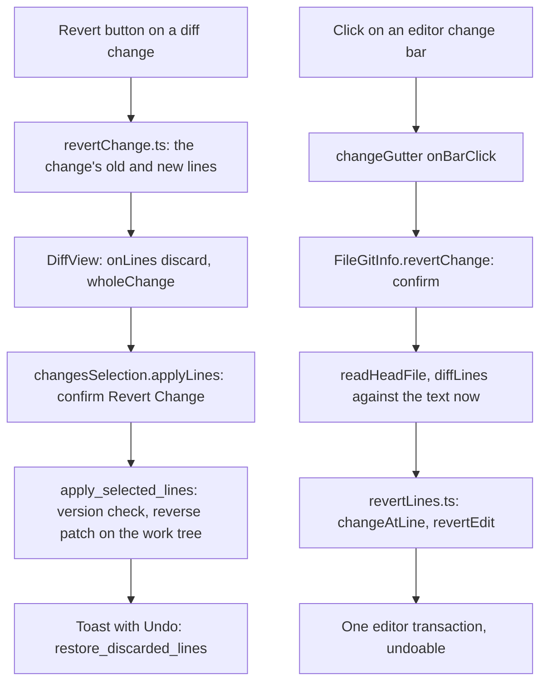

# How reverting a change works

This chapter explains the Revert button on each change of the Changes diff and the click on a change bar in the file editor. The user side is in [Revert a Change](../usage/Revert-a-Change.md). The diff itself is in [How Diffs Work](How-Diffs-Work.md) and [How the inline diff works](How-the-Inline-Diff-Works.md); the editor and its change bars are in [How the Editor Works](How-the-Editor-Works.md).

## Why we need it

Staging one change was already one click, but throwing one away meant selecting its lines and running Discard Selected Lines, or editing by hand. PhpStorm and GitLens put a revert action on every change, and users expect it in both the diff and the editor.

## How it works

The two places revert against different versions, because each shows a different comparison: the Changes diff compares the index with the working tree, and the editor's bars compare the editor's text with HEAD. So they take two paths.

### In the Changes diff

Side by side, `DiffFrame` takes `onrevert` and `revertTitle` and passes them to `MergeConnector`, which draws a button with the `discard` icon on each band, on the far side of the Stage arrow (where the merge tool's Ignore button goes). `DiffEditors.changeLines(index)` turns the `MergeView` chunk into line ranges with `chunkSelection`. A chunk's `to` is one past its last line break and may point past the end of the text, so `chunkLines` clamps it.

Inline, `inlineView.ts` adds a second button after Stage in the control gutter. Each block already carries its backend hunk, so `hunkSelection` reads the lines straight from it.

Both end in `onLines("discard", lines, true)`, the Discard Selected Lines path in `changesSelection.applyLines`. The backend checks the diff's `version`, so a file that changed since the diff was shown is refused, and the Undo in the toast applies the saved patch again. `wholeChange` only changes the confirm's words to Revert Change. Revert is offered only in unstaged mode: a staged diff has Unstage, which already moves a change back.

### In the editor

`changeGutter` takes an optional `onBarClick`. Its `mousedown` handler looks up the gutter's own markers on the clicked line, so a click beside an unchanged line or on a conflict's bar does nothing. `FileGitInfo.revertChange` then:

1. Confirms with a danger dialog.
2. Reads HEAD's file with `readHeadFile` (LF text, the path HEAD has for a staged rename).
3. Diffs it with the editor's text as it is now (`diffLines`), so edits made while the dialog was open count.
4. Picks the change with `changeAtLine`: the hunk holding the line, or the deletion whose wedge sits on it (at the end of the text, the last line).
5. Dispatches the edit from `revertEdit` as one transaction with `userEvent: "input.revert"`.

## Where the code lives

| File | What it does |
| --- | --- |
| `ui/web/src/lib/components/MergeConnector.svelte`, `DiffFrame.svelte` | The Revert button on each band (UI library) |
| `src/lib/diff/revertChange.ts` | A chunk's or a hunk's lines as a `LineSelection` |
| `src/lib/diff/inlineView.ts` | The inline Revert button after Stage |
| `src/lib/diff/DiffView.svelte`, `diffEditors.svelte.ts` | Wiring the buttons to `onLines` |
| `src/lib/views/changes/selection.svelte.ts` | `applyLines`, the confirm and the Undo toast |
| `src/lib/editor/scrollMarkers.ts` | `changeGutter` and its bar click |
| `src/lib/editor/revertLines.ts` | `changeAtLine` and `revertEdit` |
| `src/lib/views/files/fileGitInfo.ts` | `revertChange` for the editor |

## Design decisions

**Reuse Discard Selected Lines in the diff.** It already checks the version, keeps the patch for Undo and serializes with staging. Copying a chunk in the editors (as Stage does) would need a write of the work tree file, which the diff never does.

**Edit the buffer in the editor, not the file.** The editor may hold unsaved text the disk does not have. An editor transaction keeps undo, auto save and the dirty state working as for typing.

**Diff again on click.** The bars come from the backend and may be up to 200 ms old. Diffing HEAD with the text of that moment means the revert always matches what is there. Past `MAX_EDITS` the diff is one big change, so the whole range reverts.

**Always confirm.** Reverting loses work, and a click on a 5 pixel bar is easy to make by mistake.

## Tests

- `src/lib/diff/revertChange.test.ts`: a chunk's and a hunk's lines, empty sides, a last line without a break.
- `src/lib/editor/revertLines.test.ts`: the change on a clicked line, and reverting changed, added and deleted lines at the start, middle and end.
- The backend path is covered by the `apply_selected_lines` tests in `src-tauri/src/commands/lines.rs`.

The buttons, the hand pointer and the confirms need a check in the app. See [Testing](Testing.md).

## Keeping this page in sync

- Update this page when the Revert buttons move, when `applyLines` or `changeGutter` change, or when the editor's bars compare with something other than HEAD.
