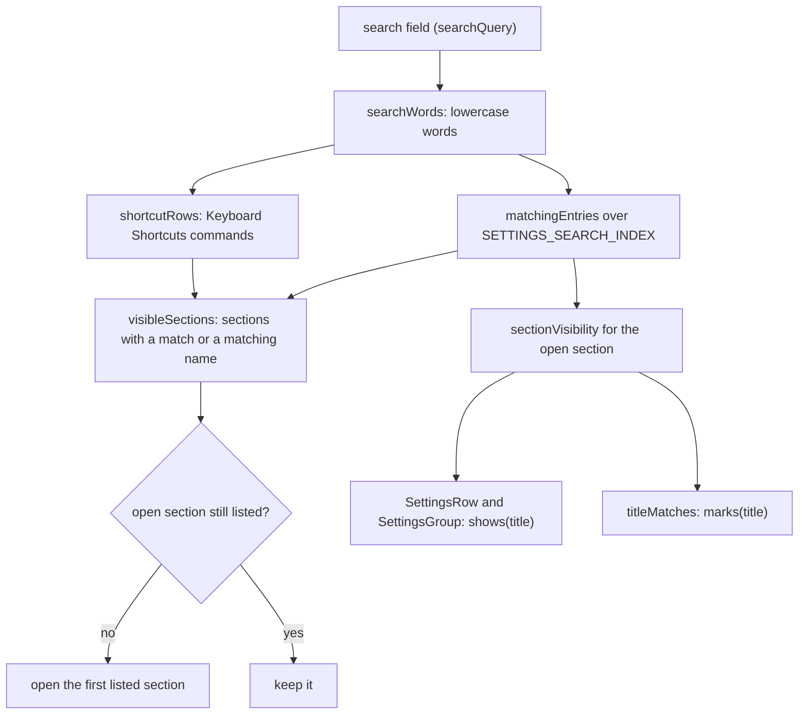

# How search in Settings works

This chapter explains the search field of the Settings dialog: how it finds sections and rows, and how the open section shows only its matches. The user side is in [Search in Settings](../usage/Settings-Search.md); the dialog itself is in [How settings work](How-Settings-Work.md).

## Why we need it

Settings has eleven sections and well over a hundred rows. Finding one setting meant guessing its section and scrolling. A search field that narrows the section list and points at the rows is quicker, and it also helps people who call a setting by another name (a "ruler" is our **Right margin line**).

## How it works

There are three parts: an index of what the dialog shows, a word matcher, and the rows themselves, which ask whether they show and what to mark.

### The index

`src/lib/views/settings/settingsSearch.ts` holds `SETTINGS_SEARCH_INDEX`: one entry per row and group title of each section, with:

- `label`: the title exactly as the row or group shows it, so the row can find its entry.
- `keywords`: other words that find the row, such as synonyms and words from its hint.
- `parent`: for a row that only shows while another setting is on (Margin column, Cursor width, the File toolbar switches), the row to point at while it is hidden.

Rows drawn from lists (`FILE_TOOLBAR_SWITCHES` and the lists in `settingsRows.ts`) are added from those lists, so they cannot drift. The dialog renders from the same lists.

### Matching

`searchWords` lowercases the query and splits it on anything that is not a letter or digit. An entry matches when every word starts a word of its label, its keywords or its section's name (`textMatches`). Matching word starts, not any substring, keeps short words from lighting up half the dialog.

The Keyboard Shortcuts section has no index entries. Its commands come from the command registry, so the dialog asks `shortcutRows` (the same filter that list uses) how many commands match. When some do, the section stays listed and `KeyboardShortcuts.svelte` gets the query through its `filter` prop.

### Showing and marking

`settingsVisibility.ts` turns the matched entries into what the open section shows. The index is in page order, and
`SETTINGS_GROUP_TITLES` says which entries are group titles; every other entry is a row, or a sub-row when it names
a `parent`. `visibleBlocks` (pure, in `settingsSearch.ts`) then decides:

- a matched row, and the sub-rows right under a matched row;
- every row of a group whose title matched;
- a group title and its hint while any row of the group stays.

A found sub-row also shows and marks its parent, since the sub-row is hidden while its parent's switch is off. Each
shown title gets its marks from `highlightSpans`; a title found only by its keywords is marked whole.

`SettingsSearchView` (`settingsSearchView.svelte.ts`) holds the words and the open section and is given to the rows
through Svelte context. `SettingsRow` (the library `SettingRow`) and `SettingsGroup` (a `SectionTitle`) ask it
`shows(title)` and pass `marks(title)` as `titleMatches`, which the library draws in the warning tint. A row the
index does not list follows its group's own match. The About links ask the same view. When nothing matches
anywhere, a short message replaces the rows.

## Where the code lives

| File | What it does |
| --- | --- |
| `src/lib/views/settings/settingsSearch.ts` | The index, `searchWords`, `textMatches`, `matchingEntries`, `highlightSpans`, `visibleBlocks` |
| `src/lib/views/settings/settingsVisibility.ts` | What a section shows and marks for the matched entries |
| `src/lib/views/settings/settingsSearchView.svelte.ts` | The search state given to the rows through context |
| `src/lib/views/settings/SettingsRow.svelte`, `SettingsGroup.svelte` | Rows and group titles that hide and mark themselves |
| `src/lib/views/settings/settingsRows.ts` | Row lists shared by the dialog and the index |
| `src/lib/views/SettingsDialog.svelte` | The search field, the filtered section list, Esc handling |
| `src/lib/views/settings/KeyboardShortcuts.svelte` | The `filter` prop that fills its own search |

## Design decisions

**A written index, not one read from the page.** Only the open section is rendered, so the page alone cannot tell which other sections match. Rendering every section to read it would mount the GitHub form, the shortcut list and the theme lists just to search. A small index in a `.ts` file costs nothing, can carry extra words, and is tested against the dialog.

**Rows decide from the index, not from the page.** The first version read the labels off the page, hid blocks with a
data attribute and painted matches with the CSS Custom Highlight API, which tied the search to the dialog's own
classes. Since Settings is built from UI library components, each row asks the search view instead: the same rules
work on every platform's library, and a row cannot drift from its entry because the test reads the titles.

**Show only the matches.** Highlighting alone left the matches spread over a long page. Hiding the rest puts every match on screen at once, while group titles and parent rows keep the context.

**Word starts.** Matching inside words found too much (`tab` in "detectable", `size` in "resize"). Starting at a word is how people type a setting's name.

**Keep the open section while it matches.** Jumping to the first section on every key press would move the page under the user. It only changes when the open section has nothing left.

**Focus the field on open.** The dialog is usually opened to change one thing, so typing right away is the fastest path. Esc empties the field before it closes the dialog.

## Tests

- `src/lib/views/settings/settingsSearch.test.ts`: reads `SettingsSectionView.svelte` and the section files it shows, and checks that every literal row title, group title and About link is in the index for its section, that the index lists nothing the dialog does not show, that every `parent` exists, and that labels are unique per section. It also covers `searchWords`, `textMatches`, `matchingEntries`, `highlightSpans` and `visibleBlocks` (groups, sub-rows, other blocks, no match).

- `src/lib/views/settings/settingsVisibility.test.ts`: a matched row and its group title, a matched group, a found
  sub-row with its parent, a keyword match marked whole, and entries of other sections.

The hidden rows, the mark color and the focus on open need a visual check in the app.

## Keeping this page in sync

- A new `SettingsRow` or `SettingsGroup` in a section file needs an entry in `SETTINGS_SEARCH_INDEX`, in page order;
  the test fails until it has one. Give it a `parent` when it only shows under another setting, and add a new group
  title to `SETTINGS_GROUP_TITLES`.
- A new section file must be shown from `SettingsSectionView.svelte`, so the test reads it.
- Update [Search in Settings](../usage/Settings-Search.md) when matching or the field changes. See [Docs and Screenshots](Docs-and-Screenshots.md).
