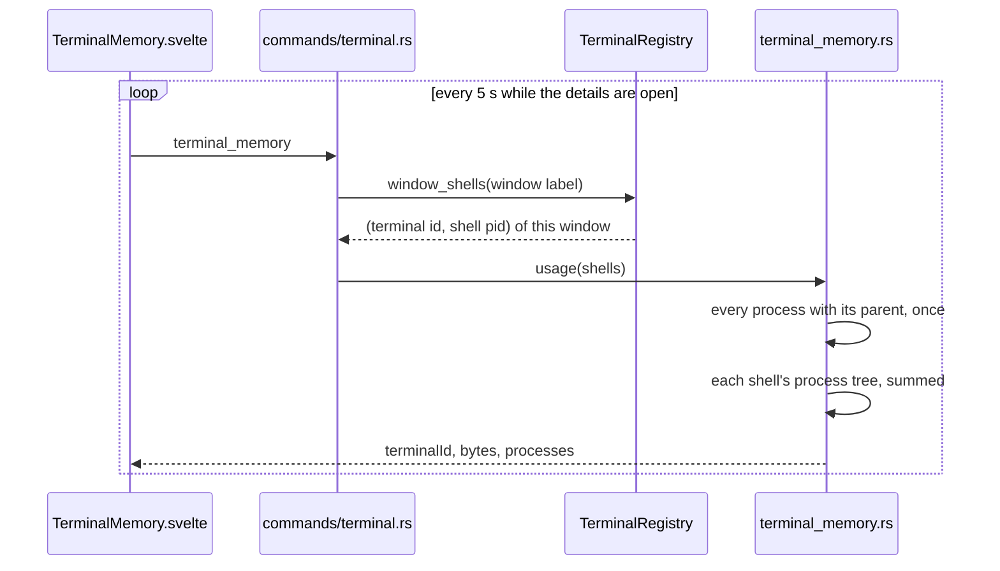

# How Terminal Memory Is Measured

The memory details in the status bar have a **Terminals** section: the sum, then one row per terminal, AI agent or run of the window. The user side is in [Memory Use](../usage/Memory-Use.md#terminals); the app's own readout is in [How Memory Is Measured](How-Memory-Is-Measured.md).

## Why we need it

The readout counts the app and its web view, not what runs in the terminals. An AI agent such as Claude Code is a big Node.js program, and a dev server or test run started in a terminal can use more memory than the whole app. Without this section the user cannot tell which tab holds it.

## How it works

- **Which terminals.** `TerminalRegistry::window_shells` returns the running shells the asking window owns (terminals, agent tabs and Run tab scripts), so each window lists only what it can name.
- **The process tree.** A terminal is its shell plus everything below it: the agent, `node`, `git`, a dev server. `memory::process_parents` lists every process with its parent once per reading. On macOS it reads `pbi_ppid` with `proc_pidinfo(PROC_PIDTBSDINFO)`; on Windows it reuses the Toolhelp snapshot. `process_tree` walks down from the shell and takes each pid once, so a stale list with a reused pid cannot loop.
- **The bytes.** Each process counts like the readout (`memory::process_bytes`): the physical footprint on macOS (Activity Monitor), the private working set on Windows (Task Manager). A process that ended between the two steps is left out. Linux returns nothing, so the section stays hidden there, like the readout.
- **The rows.** `terminalMemoryRows` (`src/lib/terminal/terminalMemory.ts`) matches each result to the window's terminal by `terminalId`: an agent shows its title and folder, a run its script name, a terminal its tab name. Rows go biggest first; the head shows the sum. Clicking a row shows that terminal with `terminalStore.showTerminal` and closes the details.

## Where the code lives

| File | What it does |
| --- | --- |
| `src-tauri/src/terminal_memory.rs` | `process_tree`, `usage`, the `TerminalMemory` result |
| `src-tauri/src/memory.rs` | `process_parents` and `process_bytes` for each system |
| `src-tauri/src/terminal.rs` | `TerminalRegistry::window_shells` |
| `src-tauri/src/commands/terminal.rs` | `terminal_memory` |
| `src/lib/terminal/terminalMemory.ts` | Rows, sum and tooltips |
| `src/lib/terminal/TerminalMemory.svelte` | The section in the details |
| `src/lib/ui/formatBytes.ts` | KB, MB and GB, shared with the readout |

## Design decisions

**Not part of the app's total.** The status bar number stays what Activity Monitor shows for Nibtree. Terminal programs are separate processes the user started, so they get their own sum, and the section says so.

**Measured only while the details are open.** The section polls every 5 seconds while it is on screen and stops when it closes, so nothing runs in the background. One process list per reading serves every terminal.

**One window's terminals.** The page can name only its own terminals; other windows show theirs.

## Tests

- `src-tauri/src/terminal_memory.rs`: the tree below a shell, a reused pid that would loop, ended processes left out of the sum, and on macOS and Windows a real shell with children measured.
- `src-tauri/src/terminal.rs`: `closing_a_window_kills_only_its_own_shells` also checks `window_shells` per window.
- `src/lib/terminal/terminalMemory.test.ts`: names and kinds of rows, biggest first, a terminal the window no longer lists, the tab name before an agent has a title, tooltips and `formatBytes`.

## Keeping this page in sync

- Update this page and [Memory Use](../usage/Memory-Use.md#terminals) when the section or what it counts changes.
- Retake `memory-terminals.png` when the details change.
