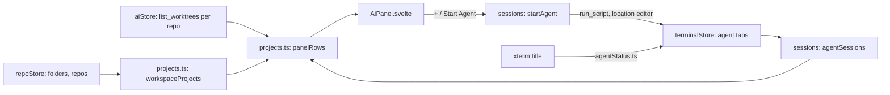

# How the AI Panel Works

The AI panel lists the workspace's projects, their worktrees and the AI agents running in them, and starts agents in editor tabs. New Task and Finish Task are in [How AI Tasks Work](How-AI-Tasks-Work.md). The user side is [AI Agents](../usage/AI-Agents.md); worktrees themselves are in [How Worktrees Work](How-Worktrees-Work.md), terminals in [How the Terminal Works](How-the-Terminal-Works.md).

## Why we need it

People run coding agents (Claude Code, Codex...) beside their editor, often several at once, each in its own git worktree so they never edit the same files. [Orca](https://github.com/stablyai/orca) showed the shape: projects, worktrees under them, agent tabs under those, and a status for each agent. Git Manager already had worktrees and terminals in editor tabs, so the panel ties them together.

## How it works

### The right sidebar

`settings.rightPanel` (`"files"` or `"ai"`, saved per window in state.json) says what the right sidebar shows; `explorerOpen` still says whether it is open. `toggleRightPanel(panel)` hides the sidebar when that panel is shown and switches to it otherwise, so the two activity bar buttons (`RightActivityBar.svelte`) behave like the left bar's. `settings.filesPanelShown` and `aiPanelShown` are what menus, MCP and the buttons read. `Workspace.svelte` mounts one panel at a time.

### Projects, worktrees and rows

`workspaceProjects(folders, repos)` turns the workspace into projects, like Orca: every workspace folder (a plain folder project, unless the folder is a repository itself), then the repositories found in it, without submodules. `aiStore.loadWorktrees(roots)` reads `list_worktrees` for each repository when the panel opens, on Refresh, after the panel's own changes and when the active repository's refs change (their fingerprint covers worktrees). Nothing polls.

`panelRows(projects, worktrees, sessions, collapsed)` builds the flat row list:

- **One project per repository.** A linked worktree the workspace opened as a folder is a repository too. Every loaded list maps its worktrees to their main worktree; a project's own list wins (a moved worktree folder is listed by its old path). Projects with the same main worktree become one, named after the main folder.
- **Each worktree once.** A worktree two lists name stays under the first project, so row keys never repeat.
- **Agents in the deepest place.** An agent tab goes under the worktree or plain folder holding its folder (the longest match); tabs outside every project come last under "Other folders".

### Cards

`panelView.ts` draws the rows like Orca's sidebar: `groupRows` makes a section per project with a card per worktree and its agents inside; `filterRows` keeps what matches every word of the filter, with the worktree and project around a matching agent; `mostUrgent` gives a card its mark; `attentionCounts` fills the "needs you" and "working" pills; `formatAge` writes "4m" from the agent's `changedAt`, refreshed every 30 s while the panel is open. `AgentStateIcon.svelte` draws the marks (the spinner only while an agent works). Menus and worktree actions live in `panelActions.ts`.

### Starting an agent

`agents.ts` is the catalog: id, label, program and the full-autonomy flags, taken from Orca's `tui-agent-permissions.ts`. These are defaults: `agentConfig.ts` applies the user's Settings > AI changes (`aiAgentCommands`). The Rust command `find_agent_programs` (`commands/ai.rs`, `run_process::find_programs`) resolves each program on the login shell's environment, the same one the Run tab uses, with Windows' PATHEXT. Only bare names are looked up.

`startAgent(agentId, folderPath)` (`sessions.svelte.ts`) asks the permission mode on the first start (`dialogs.choose`, saved as `aiPermissionMode`), adds the flags in full mode and the user's extra arguments (`splitArguments`, shell-like quoting, nothing expanded), and calls `terminalStore.startAgent`. That is a terminal entry with `location: "editor"`, a `run` spec (so `run_script` starts the exact file that was found, in the worktree) and an `agent` record (`agentId`, `folderPath`, `title`, `state`).

### The + after an agent's tab

`EditorTabs.svelte` derives `agentFolder`, the worktree of the agent its group shows, and draws a **+** after the tabs while there is one. It focuses that group and opens `startMenu(agentFolder)`, so the new agent or Blank Terminal opens beside it.

### Status

`TerminalView` passes each title change to `terminalStore.setAgentTitle`. `agentStatus.ts` reads it like Orca: braille or quarter-circle spinners and Gemini's ✦ mean working; Claude's ✳ and Gemini's ◇ mean idle; ✋ or "action required" mean the agent waits for the user. `nextState` turns that into Starting, Ready, Working, Needs you, Done or Exited. The stored title is cleaned of spinner frames, so the store only changes when the state or the words change, not on every frame; a title that only states the status ("claude - action required") keeps the last task title (`isStatusOnlyTitle`). A change from Working to Done or Needs you while the tab is hidden rings the tab's bell, and the robot button shows a dot.

An agent tab survives a clean exit (shells close), shows "Agent exited" with Restart, and keeps its `agent` and `run` across [Clear Cache](How-Clear-Cache-Works.md) (`terminalStash.ts`). Restart is a `restartRequest` the tab's `TerminalView` answers with its Retry path.

## Where the code lives

| File | What it does |
| --- | --- |
| `src/lib/ai/projects.ts` | Projects, one per repository, and the panel rows |
| `src/lib/ai/agents.ts` | Agent catalog, argument splitting, command line |
| `src/lib/ai/agentStatus.ts` | Title to status and state |
| `src/lib/ai/aiStore.svelte.ts` | Worktree lists, collapsed rows |
| `src/lib/ai/sessions.svelte.ts` | Installed agents, starting, the permission question, New AI Agent |
| `src/lib/ai/panelView.ts` | Sections and cards, filter, counts, ages, agent marks |
| `src/lib/ai/panelActions.ts` | Row menus, New Worktree, Remove Worktree |
| `src/lib/ai/AiPanel.svelte`, `AgentStateIcon.svelte` | The panel and its state marks |
| `src/lib/ai/AiAgentSettings.svelte` | Settings > AI agent list |
| `src/lib/terminal/terminalStore.svelte.ts` | `startAgent`, `restartAgent`, `setAgentTitle`, agent menus |
| `src-tauri/src/run_process.rs`, `commands/ai.rs` | `find_agent_programs` |

## Design decisions

**Agent tabs are terminals.** They reuse the PTY, output flow, find, links, Clear Cache and editor tabs, so an agent behaves exactly as in a terminal.

**Run the found file.** The panel starts the path detection reported, so what runs is what Settings shows, and screenshots can use a stand-in agent.

**Ask once, then a setting.** Full autonomy is useful in a worktree but risky in a main checkout, so the user chooses it knowingly on the first start.

**Titles, not hooks.** Orca also installs agent hooks; titles need no setup and cover the agents we list.

## Tests

- `projects.test.ts`: projects from folders and repositories, rows, the deepest place, collapsed rows, linked and moved worktrees, unique keys.
- `panelView.test.ts`: sections and cards, the filter, urgency, counts, ages.
- `agents.test.ts`, `agentStatus.test.ts` (Orca's title cases), `sessions.test.ts`.
- `terminalStash.test.ts`: agent tabs across Clear Cache.
- Rust: `run_process` tests find only bare executable names, and `.cmd` files with Windows extensions.
- Screenshots `ai-panel`, `ai-new-tab`, `ai-permission` and `ai-settings` run a stand-in agent from the demo folder (`writeDemoAgent` in `scripts/screenshots.ts`); the page answers `find_agent_programs`, so a real agent never runs.

## Keeping this page in sync

- Add an agent in `agents.ts`, its name in `agentStatus.ts` when its titles carry it, and the user page's list.
- Retake the three screenshots when the panel's look changes.

## Bugs we fixed

**The window stopped updating when the AI panel opened.**
- **The issue:** with linked worktrees open as folders, the panel showed only "main" rows and the whole window stopped reacting.
- **Why it happened:** a moved worktree folder's list named the main worktree again, so two rows had the same key, and Svelte's keyed each block threw during an update.
- **The fix and why we chose it:** one project per repository, grouped by main worktree, and each worktree listed once, so keys cannot repeat whatever the lists say.
