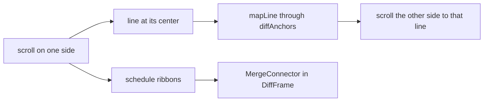

# How the connected diff works

The side by side diff shows each side as plain code, with no blank padding, and draws a band between the sides for every change. This page explains how. The rest of the diff is in [How diffs work](How-Diffs-Work.md); the user side is in [Diffs](../usage/Diffs.md).

## Why we need it

`@codemirror/merge`'s `MergeView` lines the two sides up by adding blank spacers to the shorter side, and both sides scroll in one container. When one side gains many lines, the other side shows a big empty gap, and it is hard to see where a block came from or went. A connected diff keeps both texts whole, scrolls each side on its own while keeping matching lines level, and draws a curved band from a change's lines on the left to its lines on the right. The user asked for that look.

## How it works

We keep `MergeView`, because its chunks, line and character highlights, change gutter, `getChunks` and `mergeViewSiblings` power folding, staging and the overview ruler. Only three things change:

1. **No padding.** `unpadded(view)` in `splitLink.ts` replaces the view's private `measure`, which only adds the spacers (it also placed the old revert buttons, which we no longer use).
2. **One scroller per side.** `DiffFrame` (UI library) gets `ribbons`. With them it gives each `.cm-editor` the full height and its own scrolling `.cm-scroller`, overriding the base theme that makes the editors grow inside one scroller. The gap between the sides is the `mergeView.gap` token.
3. **Bands and synced scrolling.** `SplitLink` listens to both scrollers.

`splitChunks.ts` holds the pure parts:

- `chunkLines(chunk, a, b)`: a chunk's lines on each side, 0-based and end-exclusive. An empty range is the gap between two lines, so a band from it is a point that fans out to the added lines. An empty change after the last line sits after it.
- `chunkKind`: added, deleted or modified, for the band's color.
- `diffAnchors`: pairs of matching lines at every change's edges, used with the merge tool's `mapLine` and `invertAnchors`. The line at the center of the scrolled side is mapped and the other side is scrolled to put that line at its center, the way the merge tool's `ScrollSync` does it. A lock skips the scroll events the follower causes.
- `copyChange`: the edit behind a band's arrow. It is the same as `MergeView`'s own revert: the chunk's lines with their line break, unless they end the text.

`SplitLink.ribbons()` measures the changes with lines on screen with the merge tool's `span`, in pixels from the frame body's top, and drops bands far off screen. `DiffEditors` keeps them in `ribbons`, and `DiffView` passes them to `DiffFrame`, which draws the library's `MergeConnector`. The ruler's geometry updates also schedule the bands, so folds, edits and resizes move them.

The arrow on a band is **Stage this change** (Changes) or **Unstage this change** (Staged). `DiffEditors.copyChange` dispatches the edit with the `revert` user event, so the listener that writes the index runs as before. Read-only diffs draw the bands without arrows: `MergeConnector` shows a button only with its handler.

## Fold labels

A fold names the code after it: the library's `FoldRowWidget` (`editor/foldRow.ts`, drawn for `foldField.ts`) reads `scopeLabelAt(state, line)` (`foldScope.ts`) for the line below the fold. That uses sticky scroll's `scopeSource` (the syntax tree, markdown headings or indentation) for the enclosing blocks, takes each block's first line (or the line before a lone `{`), and `foldLabel.ts` turns them into names: `class Cart` is `Cart`, `public function store(` is `store()`, and blocks such as `if` drop out. A PHP `namespace` or Java `package` line leads the label. With no named block the bar shows the count. The wavy line is a CSS mask, so it takes the theme's `--border-strong`. The 3-pane merge diff folds the same runs in all panes and mirrors each step (`foldStep`) to the others.

## Where the code lives

| File | What it does |
| --- | --- |
| `src/lib/diff/splitChunks.ts` | Lines, kinds, anchors and the copy edit of each change |
| `src/lib/diff/splitLink.ts` | `unpadded`, synced scrolling, band measuring, `copy` |
| `src/lib/diff/diffEditors.svelte.ts` | Owns the link, `ribbons` and `copyChange` |
| `src/lib/diff/foldLabel.ts`, `foldScope.ts` | Fold labels |
| `ui/web/src/lib/components/DiffFrame.svelte` | `ribbons`, `applySide`, `onapply`, `applyTitle`; one scroller per side |
| `ui/web/src/lib/components/MergeConnector.svelte` | The bands and their optional buttons |
| `ui/web/src/lib/editor/splitGutters.ts` (`splitPaneGutters`) | Colored number rows, numbers facing the middle, the change buttons |

## Design decisions

- **Keep MergeView.** Writing our own two-editor diff would mean rebuilding highlights, the gutter and the chunk updates on edits. Turning off one private method is a small, contained dependency; a `@codemirror/merge` update that renames `measure` brings the padding back but breaks nothing else.
- **Center line sync.** Mapping the center keeps the change you look at level on both sides, even inside a long added block.
- **Buttons beside the line numbers.** A change's stage, unstage, apply and revert buttons sit in its side's gutter on its first line (the library's `splitPaneGutters` in `editor/splitGutters.ts`, built on `editor/mergeGutters.ts`), next to the numbers but never over them. The old side's numbers move to its right edge (`sideLineNumbers("after")`) and each change's color runs through the numbers (`splitGutterColors`, from `getChunks`), so a band reads as one shape from text to text. With no buttons on it, the connector is narrow, and only the new side keeps a vertical scrollbar. The merge tool and the three-pane diffs draw the same way.

## Tests

- `src/lib/diff/foldLabel.test.ts`: names of classes, functions, methods and headings, skipped control blocks, namespaces.
- `src/lib/diff/splitChunks.test.ts`: changed, added and removed lines, changes at the end of the text, anchors, and staging and unstaging edits checked against the other side's text.
- `ui/web/src/lib/editor/splitGutters.test.ts`: each side's rows of a changed, added or removed block.
- The look and the scrolling need a visual check: `diff-view`, `diff-hunk-staging`, `commit-tab` and `color-theme-high-contrast` in `scripts/screenshots.ts`.

## Keeping this page in sync

- A new way to change a side must keep the `revert` user event, or the index is not written.
- After updating `@codemirror/merge`, check that `measure` still only adds spacers.
