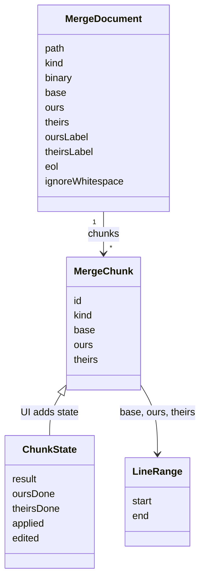
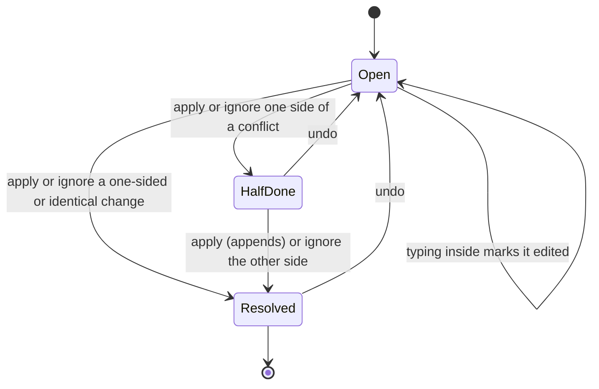

# How the merge tool works

The merge tool is a three pane view (Yours, Result, Theirs) with connectors between the panes and apply and ignore buttons beside each change's line numbers. The user side is in [Merge Tool](../usage/Merge-Tool.md).

## Why we need it

Conflict markers are hard to read. A merge dialog shows both sides next to the result and takes changes with one click; building that, light on memory, was the original goal of Nibtree. Rust computes the chunks once, and pure, tested TypeScript tracks what you did with them.

## How it works

### Loading a conflict

`conflicts::load` reads the three index stages (base, ours, theirs), and `build_document` makes a `MergeDocument`, normalized to LF with the original `eol` kept. A stage that is not UTF-8 marks the document `binary`, with no chunks. For a deleted side (empty text), `MergeView` first offers the per-file choices, with Merge Text Anyway.

`compute_chunks` in `merge/engine.rs` diffs base to ours and base to theirs (imara-diff, histogram), then walks both hunk lists together. Hunks that overlap **or touch** in the base form one chunk, as in git's xdiff. Each chunk is `oursOnly`, `theirsOnly`, `bothSame` or `conflict`. Ignore whitespace diffs whitespace-normalized lines, so ranges still address the original lines.

Lines split on `\n` as in CodeMirror, so a Rust `LineRange` matches the editor lines.

### Resolving in the UI

`MergeView.svelte`, a `WindowLayer` over the main window, loads the document for `MergeEditor.svelte`. `MergeSession` (`mergeSession.svelte.ts`) builds three editors (sides read-only) into the panes of the UI library's `MergeFrame`. The Result starts from the **base** text and holds the chunk state in `chunkField`, a StateField in `extensions.ts`.

`initialChunks` marks the unchanged side done. Each button calls a pure function in `model.ts` and dispatches the result as one transaction:

- `applySide` replaces the chunk's result lines with one side. On a conflict, a second apply **appends** the other side.
- `ignoreSide` marks a side handled without touching the text.
- `applyNonConflicting` applies every unresolved, unedited non-conflict chunk, optionally from one side.
- `acceptWholeSide` replaces the whole result (Accept Left and Accept Right).
- `mapChunks` moves chunk ranges through your typing and marks chunks you type in as `edited`.

`dispatchAction` sends the text edit with `setChunks` and `isolateHistory.of("full")`, so each click is one undo step, and `chunkHistory` (`invertedEffects`) makes undo restore text and chunk state together.

`draw` builds SVG ribbons for the visible chunks. The library's `editor/mergeGutters.ts` draws the rest of each band: `chunkGutterClasses` colors a chunk's gutter rows, and `paneGutters` puts a side's numbers next to the result with a button column beside them (`sideGutters` wires Apply and Ignore). Yours keeps its ruler at its outer edge, the result draws its ruler over its lines' ends, and only Theirs keeps a vertical scrollbar, so a band runs unbroken from pane to pane. The panes use `baseExtensions`, so each has the find bar and the whitespace setting; opening a find bar moves the text, so `onSideGeometry` redraws on geometry changes. Scrolling one pane scrolls the others through `mapLine`, a piecewise linear mapping between chunk edges. `changedSpans` in `inline.ts` adds word highlights. F7 and Shift+F7 use `findUnresolved`.

Cmd+Enter saves from any pane (a high-priority keymap from `applyKeymap`). Escape, Cancel and the title-bar close button all run `cancel`, which asks first when there is undo history. Ignore whitespace recomputes the chunks, after a confirm. `save` warns about unresolved changes and leftover markers, then `saveResolution` writes and stages the file. The same editor runs as `git mergetool`, see [How mergetool mode works](How-Mergetool-Mode-Works.md).

## Where the code lives

| File | What it does |
| --- | --- |
| `src-tauri/src/merge/engine.rs` | `compute_chunks`, the git comparison test |
| `src-tauri/src/merge/model.rs` | `LineRange`, `MergeChunk`, `MergeDocument`, `Eol` |
| `src-tauri/src/git/conflicts.rs` | `load` and `build_document` |
| `src-tauri/src/commands/merge.rs` | `load_conflict`, `save_resolution` |
| `src/lib/merge/model.ts` | Pure chunk actions, line edits, scroll mapping |
| `src/lib/merge/extensions.ts` | `chunkField`, undo support, line decorations, the Cmd+Enter keymap |
| `src/lib/merge/inline.ts` | Word-level highlights |
| `src/lib/merge/MergeEditor.svelte` | Toolbar, `MergeFrame`, footer, save and cancel |
| `src/lib/merge/mergeSession.svelte.ts` | The three editors, chunk actions, undo, navigation |
| `src/lib/merge/mergeRibbons.ts`, `mergeScroll.ts` | Connector ribbons, synced scrolling |
| `ui/web/src/lib/editor/mergeGutters.ts` | Gutter colors, numbers on either side, the chunk buttons |
| `src/lib/merge/MergeView.svelte` | The overlay, reload and file-level fallbacks |

## Design decisions

**Our own engine, checked against git.** `git merge-file` gives marker text, not chunk ranges for a UI, so a property test compares our clean merges with it.

**Chunk state inside the editor.** In a StateField, undo never leaves text and buttons out of step.

**Buttons beside the numbers, not over them.** They get their own gutter column, so every line number stays readable, and the gaps between panes only carry the ribbons. The 3-pane diff and the library's MergeView draw the same way.

**One overlay, not a second window.** Every window starts another web view process, which costs memory.

## Bugs we fixed

See [Merge Tool Bugs We Fixed](Merge-Tool-Bugs-We-Fixed.md).

## Tests

- `src-tauri/src/merge/engine.rs`: chunk kinds, touching changes, offsets, final newlines, ignore whitespace and the comparison with `git merge-file`.
- `src-tauri/src/git/tests.rs`: the `load_*` tests (chunks, CRLF, both added, deleted, binary, ignore whitespace).
- `src/lib/merge/model.test.ts`: `replaceLines` with random edits, chunk actions, `mapChunks` and scroll mapping.
- `src/lib/merge/inline.test.ts`: word spans.
- `src/lib/merge/extensions.test.ts`: `applyKeymap` beats the default Cmd+Enter, also in the search bar.
- `ui/web/src/lib/editor/mergeGutters.test.ts`: gutter row colors, edges, gaps and tones.

Change the engine only with a new engine test; keep UI rules in `model.ts` with a Vitest case. Connectors and scrolling need a visual check. See [Testing](Testing.md).

## Keeping this page in sync

- Update this page when chunk grouping, chunk actions, undo, keys, saving or cancelling change.
- Update [Merge Tool](../usage/Merge-Tool.md) for visible changes.
- Retake `merge-tool.png` and `merge-tool-resolved.png`. See [Docs and Screenshots](Docs-and-Screenshots.md).

**The window buttons covered the merge title.**
- **The issue:** on macOS the close, minimize and zoom buttons sat on top of the merge icon and "Merge Revisions for".
- **Why it happened:** the window hides the system title strip and puts its buttons in the app's top bar, but the merge view covers that bar with its own toolbar, which left no room for them.
- **The fix and why we chose it:** the merge view's top bar is now an `AppHeader` with `windowControls`, like the `git mergetool` window, so it leaves room for the buttons, moves the window and loses the room in full screen.
