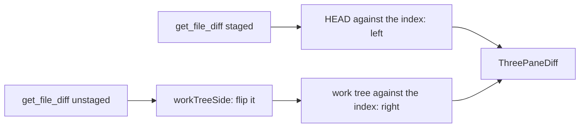

# How the staging view works

The staging view shows a file of the Changes diff in three panes: HEAD, the index and the work tree, with bands joining each side's changes to the index in the middle. It reuses the 3-pane diff of merge commits. For the user side, see [Staging View](../usage/Staging-View.md).

## Why we need it

The two-pane diff shows either the staged or the unstaged half of a file, so a file with both needs two clicks to understand. PhpStorm shows both halves at once around the index, and stages or unstages from the bands. We already had every piece: the 3-pane frame and bands of the merge tool and the merge commit view.

## How it works

`ChangesDiff.svelte` shows `ThreePaneDiff.svelte` when `diffPrefs.stagingThreePanes` is on and `stagingViewFits` says the file is a plain modified file (not new, deleted, renamed, untracked or conflicted). `StagingDiffs` (`views/changes/stagingDiffs.svelte.ts`) loads both diffs:

`ThreeWayEditors` takes each side pane against the middle. The unstaged diff runs the other way (index to work tree), so `workTreeSide` swaps its texts, EOLs and hunks (`flipHunks`). The options `{ rightNewer: true, conflicts: false }` keep its colors right (lines the work tree adds are green) and never call a change a conflict.

A band's arrow calls `ThreeWayEditors.taken(side, index)`, which `takeChange` builds: the index text with the change's lines from that side. `changesSelection.applyDiffChange` writes it to the index, the same path as the two-pane arrows. The new status reloads both diffs; `StagingDiffs` keeps a diff whose texts did not change, and `ThreePaneDiff` keeps the middle pane's scroll position when it rebuilds.

The layout buttons come from `DiffToolbar`'s `onthreepanes` (two panes to three) and `ThreePaneDiff`'s `onlayout` (back to two).

## Where the code lives

| File | What it does |
| --- | --- |
| `src/lib/views/changes/stagingDiffs.svelte.ts` | Which files fit, loading both diffs, the flipped work tree side |
| `src/lib/views/changes/ChangesDiff.svelte` | Picks the staging view or the two-pane diff |
| `src/lib/diff/ThreePaneDiff.svelte` | The toolbar and the frame, for merges and staging |
| `src/lib/diff/threeWay.ts` | `ThreeWayOptions`, `flipHunks`, `takeChange` |

## Design decisions

- **Off by default.** The two-pane diff stays the Changes default; the choice is remembered once made.
- **Plain modified files only.** A new or deleted file has an empty side, and a rename has two paths; the two-pane diff shows them better.

## Tests

- `src/lib/views/changes/stagingDiffs.test.ts`: which files fit and the flipped work tree side.
- `src/lib/diff/threeWay.test.ts`: the staging colors, no conflicts, and staging and unstaging with `takeChange`.

## Keeping this page in sync

- Retake `diff-staging-view.png` when the view looks different.
