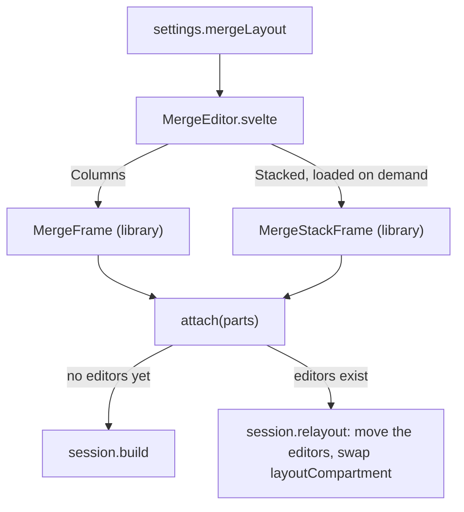

# Merge Tool Layouts

The [merge tool](How-the-Merge-Tool-Works.md) has two layouts. **Columns** shows yours, the result and theirs side by side, joined by ribbons, with each side's buttons beside its line numbers. **Stacked** shows yours and theirs on top and the result across the bottom, with a row of links above each change. The user side is in [Merge Tool](../usage/Merge-Tool.md#two-layouts-columns-and-stacked).

## Why we need it

Columns is best for small changes: every version of a line sits on one row. Long lines and narrow windows suit Stacked better, because the result gets the full width. People coming from other editors also expect one or the other, so the tool offers both and remembers the choice.

## How it works

The editors never change with the layout. `MergeEditor` shows one frame at a time; when a frame's panes appear, `attach` builds the editors the first time and later only moves them: `moveToLayout` (`mergeLayout.ts`) appends each editor's DOM to the new frame's pane and reconfigures `layoutCompartment` with that pane's extensions from `paneLayout`. So the text, the undo history and every applied or ignored change survive a switch, and the work done in one layout shows in the other.

`paneLayout` gives each pane what its layout needs:

- **Columns:** the side gutters (`sideGutters`: numbers facing the result, Apply and Ignore beside them), the result's ruler over its lines' ends and one vertical scrollbar.
- **Stacked:** plain line numbers, rulers at the right, and lenses from the library's `chunkLenses` (`editor/chunkLens.ts`). A side's lenses read its open changes from `gutterChunkField`, which the session fills with the same marks it already sends; the result's lenses come from the chunk field (`resultLenses`).

`MergeStackFrame` is imported with `import()` only when Stacked is shown, so a merge in Columns never loads it. Its top row height and the split between its top panes are layout state (`mergeStackHeight`, `mergeStackRatio` in `state.json`); a saved height too tall for the window falls back to half, so the result always shows. The toolbar buttons set `settings.mergeLayout`, the same setting as **Merge tool layout** in Settings > Git, like the Ignore whitespace button.

## Where the code lives

| File | What it does |
| --- | --- |
| `src/lib/merge/mergeLayout.ts` | `layoutCompartment`, `paneLayout`, `moveToLayout`, the lenses' links |
| `src/lib/merge/MergeEditor.svelte` | The layout buttons, one frame at a time, `attach` |
| `src/lib/merge/mergeSession.svelte.ts` | `build` with a layout, `relayout`, `acceptBoth` |
| `ui/web/src/lib/components/MergeStackFrame.svelte` | The stacked frame: two panes over one, titles, resize lines |
| `ui/web/src/lib/editor/chunkLens.ts` | Lens rows above changes, as block widgets from a StateField |

## Design decisions

**Move the editors, do not rebuild them.** Rebuilding would lose the undo history and cost a new set of editors on every click.

**Lenses instead of ribbons when stacked.** Ribbons need the panes side by side with the result between them; links above each change work in any arrangement.

**Accept both takes yours first.** It is two applies, so Undo can take back theirs alone.

**Our own names.** Columns and Stacked say what you see.

## Tests

- `src/lib/merge/mergeLayout.test.ts`: the result's notes for open conflicts.
- `ui/web/src/lib/editor/chunkLens.test.ts`: lens rows, their bars and their clicks.
- `src/lib/stores/settingsData.test.ts`: `mergeLayout` defaults to Columns and refuses unknown values; the saved stack sizes are read and kept in range.
- The look and the switch need a visual check: `merge-tool-stacked` in `scripts/screenshots.ts` opens in Columns, applies the easy changes and switches.

## Keeping this page in sync

Update it when a layout gets new extensions, or when the switch stops moving the editors.
