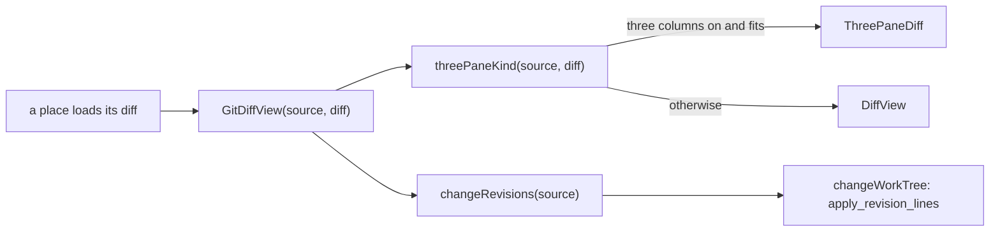

# One diff view for every place

Nibtree shows a file's diff in many places: the Changes diff and the Changes tab, a commit in the History panel or its own tab, a branch compare, Compare with Revision, the diff of a revision against the working tree, a shelf, Compare Files and local history. They all go through one component, `GitDiffView`, so they share the same toolbar, layouts, three-pane option and buttons.

## Why we need it

Each place used to pick between the two-pane `DiffView` and the three-pane `ThreePaneDiff` on its own. So they drifted apart: the Changes tab had a Revert button the History panel did not, only merge commits could show three columns, and every fix had to be made several times. A user saw "the same view" behave differently depending on where it opened.

## How it works

A place loads its two-pane diff as before and hands `GitDiffView` a `DiffSource`: what the diff compares.

| Source | Used by | Three panes | Change buttons |
| --- | --- | --- | --- |
| `changes` | Changes diff | HEAD, index, work tree | Stage, Unstage, Discard (the place's own) |
| `head` | Changes tab | HEAD, index, work tree | Revert to HEAD |
| `commit` | History panel, commit tab | parent, commit, work tree (or both parents of a merge) | Revert, Apply |
| `revisions` | Branch compare, Compare with Revision, revision against work tree | older, newer, work tree (only when the newer side is not the work tree) | Revert, plus Apply when the newer side is a revision |
| `plain` | Shelf, Compare Files, local history | none | none |

`diffSource.ts` holds the pure decisions: `threePaneKind` (which three panes fit), `panesKey` (the Settings > Git choice that picks two or three columns: one for uncommitted changes, one for commits) and `changeRevisions` (the two revisions a change's Revert and Apply work between).

When three columns are on, `GitDiffView` loads the third pane itself: `StagingDiffs` for the index and the work tree, or `WorkTreePane` for the work tree against the newer side. Both reload when the repository's status or a file version changes, and panes still loaded for another file are never shown.

### Revert and Apply

`changeWorkTree` (`diffActions.ts`) calls the `apply_revision_lines` command with the change's lines. The backend (`commands/revision_lines.rs`) reads both sides at their revisions (or the work tree file), builds a patch of only those lines with `git::partial`, and runs `git apply` (Apply) or `git apply --reverse` (Revert) on the work tree file after a `--check`. The index is never touched. A local history snapshot is taken first, and the patch comes back so the toast's Undo can run it the other way through `restore_discarded_lines`.

In three panes, the commit's bands sit between the parent and the middle, so `ThreePaneDiff` takes `lineActions` for that side: `ThreeWayEditors.change(side, index)` turns a band into the same line selection (side pane old, middle new).

## Where the code lives

| File | What it does |
| --- | --- |
| `src/lib/diff/GitDiffView.svelte` | The one view: picks the panes, loads the third one, wires the buttons |
| `src/lib/diff/diffSource.ts` | `DiffSource`, `threePaneKind`, `panesKey`, `changeRevisions` |
| `src/lib/diff/diffActions.ts` | `writeIndex` (staging view) and `changeWorkTree` (Revert, Apply, Undo) |
| `src/lib/diff/workTreePane.svelte.ts` | The work tree pane next to a commit or a compare |
| `src-tauri/src/commands/revision_lines.rs` | `apply_revision_lines` |

## Design decisions

- **Places keep loading their own two-pane diff.** Each one already loads, refreshes and lists files its own way; the view only needs the result and what it compares.
- **Apply needs a revision on the newer side.** When the newer side is the work tree, the change is already there, so only Revert is offered.
- **The patch, not the texts.** Applying a patch with context fails cleanly when the file moved on, instead of overwriting lines the user changed.
- **Shelf, Compare Files and local history stay read-only.** They are not git revisions of the same file, so a change has no clear place to go.

## Tests

- `src/lib/diff/diffSource.test.ts`: which panes fit each source, the settings, the revisions, a band's lines and the work tree pane against the middle.
- `commands/revision_lines.rs`: revert and apply one change with Undo, a change that no longer fits, a root commit's new file, the index left alone, and bad input.

## Keeping this page in sync

Update the table when a place starts showing diffs, when a source kind changes, or when a button is added. See also [How diffs work](How-Diffs-Work.md) and [How reverting a change works](How-Reverting-a-Change-Works.md).
