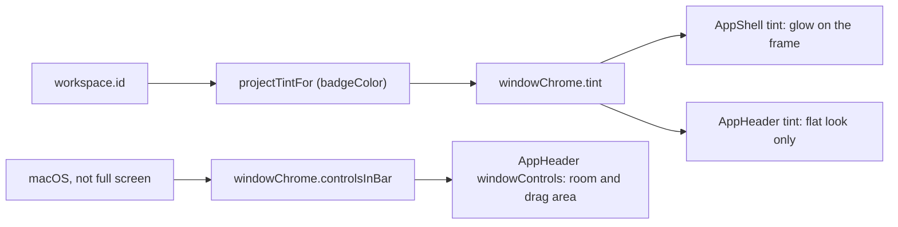

# Project color and title bar

Like PhpStorm, Git Manager tints each window in its project's color, the same color as the project's tile on the [Welcome screen](How-the-Welcome-Screen-Works.md). On macOS the window buttons sit in the app's own top bar, so the color can start at the window's top left corner.

## Why we need it

With several windows open, a color tells them apart at a glance. The system title strip on macOS sat above our top bar, so the glow had a hard edge there and the window wasted a row.

## How it works

- The open workspace's `id` is the key the Welcome list colors an entry by (the workspace file, or the folder roots joined), so `projectTintFor` (`stores/projectTint.ts`) returns that entry's `badgeColor`, or `none` when **Project color in the top bar** (`projectColorHeader`) is off.
- In the rounded look, the library's `AppShell` paints the window frame itself with a radial glow from the top left corner, `--app-shell-tint-width` by `--app-shell-tint-height`, fading to nothing. The rounded header, the activity bars and the gaps between panels are transparent, so the glow runs under all of them, and the panels sit on top.
- In the flat look, `AppHeader` draws a glow on the bar's middle line instead, fully faded at its top and bottom edges.
- The color is a terminal color (`--term-blue` and so on), so it follows the color theme, and CSS `light-dark()` makes it much fainter in light themes.

### The title bar on macOS

The windows use `titleBarStyle: Overlay` with a hidden title: in `tauri.conf.json` for the first window, and `mac_title_bar` in `commands/window.rs` for New Window. The buttons are placed by `trafficLightPosition` (`TRAFFIC_LIGHTS`), on the same line as the back arrow. `windowChrome.controlsInBar` is true on macOS outside full screen; it gives `AppHeader` `windowControls`, which leaves `--app-header-controls-inset` for the buttons and marks the bar's empty space with `data-tauri-drag-region` (the `start-dragging` and `internal-toggle-maximize` permissions). The Welcome screen and the merge tool show the same bar at their top.

## Where the code lives

| File | What it does |
| --- | --- |
| `src/lib/stores/projectTint.ts` | The open project's color |
| `src/lib/stores/windowChrome.svelte.ts` | `tint`, `controlsInBar` and full screen |
| `ui/web/src/lib/components/AppShell.svelte`, `AppHeader.svelte` | The glow, the room for the buttons, the drag area |
| `src-tauri/tauri.conf.json`, `src-tauri/src/commands/window.rs` | The macOS title bar |

## Tests

- `stores/projectTint.test.ts`: the Welcome tile's color, and none when off or with nothing open.
- `settingsData.test.ts`: the `projectColorHeader` preference.
- The look, the buttons' place and dragging need a check in the app, in a light and a dark theme.

## Bugs we fixed

**The project glow hid the activity bar icons in light themes.**
- **The issue:** with a light theme, the left strip's icons almost vanished under the project color.
- **Why it happened:** the glow used the same strength (30%) on light frames as on dark ones, and dim icons on a pale tint lose their contrast.
- **The fix and why we chose it:** the glow picks its strength with CSS `light-dark()`, so light themes get under half of it. It follows each theme's `color-scheme` with no new color tokens.

## Keeping this page in sync

Update this page when the glow's size or strength, the window buttons' place, or the Welcome tile colors change.
