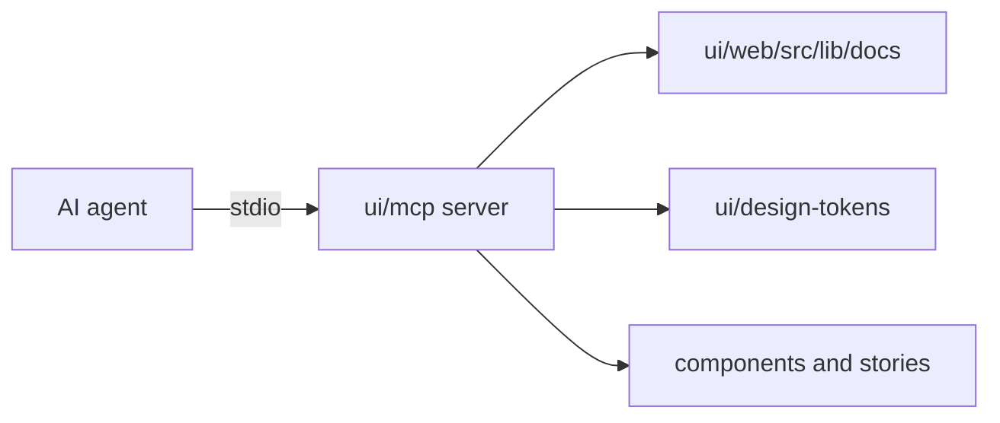

# The UI library's MCP server

## Why we need it

AI agents build screens from the [UI library](UI-Library.md). Reading every component file and token file costs time and tokens, and an agent can miss a rule. A small MCP server answers those questions directly, from the same files the library uses.

## How it works

`ui/mcp/` is a small MCP server over stdio (`bun run ui:mcp`), registered for the repository in `.mcp.json`, so AI agents such as Claude Code can ask the design system directly instead of reading files:

| Tool | Answers |
| --- | --- |
| `list_components`, `search_components` | Components by group, or by words such as "modal" or "toggle group" |
| `get_component` | The doc (usage, every prop, rules, examples), the source and the story |
| `get_tokens` | Colors, typography, sizes, layout (grid and breakpoints) or component measurements |
| `list_icons`, `get_rules` | Icon names, and the rules for building UI with the library |

Each component's page is also a resource (`gm-ui://components/<Name>`). The answers come from the same docs and token files as everything else, so they cannot drift. `ui/mcp/tools.test.ts` checks the tools and the protocol.

## Where the code lives

| Path | What it holds |
| --- | --- |
| `ui/mcp/` | The server, its tools and `tools.test.ts` |
| `.mcp.json` | Registers the server for this repository |

## Keeping this page in sync

- Update it when a tool is added, renamed or removed in `ui/mcp/`.
- The rules the server returns live in `ui/mcp/tools.ts`; keep them equal to the rules in [UI-Library.md](UI-Library.md).
