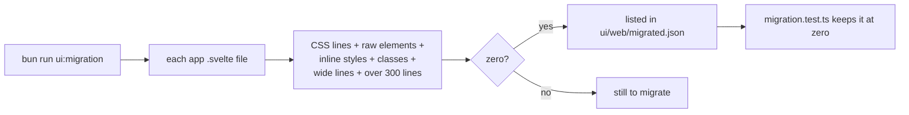

# UI library migration

The app is moving onto its own component library, screen by screen. When it is done, every screen is built only from library components, with no CSS of its own, so the design is the same everywhere and the native apps can follow the same tokens. This page explains how the app uses the library, how progress is measured and what a migrated file must look like. The library itself is described in [UI-Library.md](UI-Library.md).

## Why we need it

Before the migration each screen drew its own buttons, rows and fields with its own CSS. The same thing came out in slightly different sizes in different places (13 dialog widths, for example), and a change to the look meant editing many files. With the library, a token change updates every screen, and a screen file holds only what the screen does.

## How it works

### The library is a local package

`ui/web` is a package named `@nibtree/ui` (`ui/web/package.json`). The root `package.json` lists it as a Bun workspace and depends on it with `"@nibtree/ui": "workspace:*"`, so `bun install` links it into `node_modules`. The app imports it by name, like any package:

```ts
import Button from "@nibtree/ui/components/Button.svelte";
import { icons } from "@nibtree/ui/icons";
```

The package exports its components, logic, editor helpers, token CSS, icons and toasts. CodeMirror, xterm.js, markdown-it and Svelte are peer dependencies, so the app and the library share one copy of each. `src/routes/+layout.svelte` loads `@nibtree/ui/styles/tokens.css`, `base.css` and `code.css`; the app has no CSS file of its own. The icon set lives in the package; the app has no copy.

### Progress is a number that reaches zero



`ui/web/scripts/migration.ts` counts, for every app `.svelte` file, what it still owns instead of taking from the library: lines of its own CSS, raw HTML elements, inline styles, class attributes, lines over 120 columns, and whether it is longer than 300 lines. `bun run ui:migration` prints the table, worst first, and the total. `--update` adds every file now at zero to `ui/web/migrated.json`. A gap in the library is simply whatever stops a screen from reaching zero; it is added to the library (component, doc, story, tokens) and the screen moves on.

### What a migrated file looks like

- Only library components and app components in the markup; `Stack` lays things out and `Text` writes words.
- No `<style>`, no `class`, no `style`. Sizes are the library's named presets.
- At most 300 lines of at most 120 columns. Pure logic moves to a tested `.ts` module next to the component (for example `rebaseStart.ts`, `branchListItems` in `branchPopup.ts`).
- Shortcut hints come from `localKeys` or `commandKeys`, never typed in.

## Where the code lives

| Path | What it holds |
| --- | --- |
| `ui/web/package.json` | The package: name, exports, peer dependencies |
| `ui/web/scripts/migration.ts` | `bun run ui:migration` |
| `ui/web/migrated.json` | The files already at zero |
| `ui/web/scripts/migration.test.ts` | Migrated files stay at zero; parity reads no migrated file |

## Design decisions

- **Snap, do not copy.** When a screen used a size the library does not have, it snaps to the nearest preset instead of adding one. The Git dialogs' ten widths became the library's five (460, 520, 560, 620 and 760 px).
- **Retire parity for migrated screens.** A parity case compares a library component with the app's own CSS. Once a screen is migrated that CSS is gone, because the app now draws the library itself, so its cases are removed. A test fails if a case still reads a migrated or deleted file. With every screen migrated, the last two cases (app.css's old `.icon-btn` and `.input`) went with those classes, and the list is empty.
- **Migrate a whole family at once.** The Git dialogs shared one frame that styled their bodies through global classes, so the frame and all its dialogs moved together and the frame was deleted.

## Tests

`migration.test.ts` checks the counting on a sample, that every listed file is at zero and exists, and that no parity case reads a migrated file. `bun run check` and `bun run test` must stay clean after every screen.

## Bugs we fixed

**The migration test failed on Windows.**
- **The issue:** the Windows frontend CI failed "lists only files that exist" with every file in `migrated.json`, while macOS passed.
- **Why it happened:** `appDebts` named each file with Node's `relative()`, which uses `\` on Windows, but `migrated.json` lists paths with `/`, so no name matched.
- **The fix and why we chose it:** `repoPath` joins the parts with `/` on every platform, the same rule the app uses for paths, so the list stays one file for all platforms. A test checks that no name holds a `\`.

## Keeping this page in sync

- Run `bun run ui:migration --update` after migrating a screen, and commit `migrated.json` with it.
- Update this page when the package's exports or the rules for a migrated file change.
