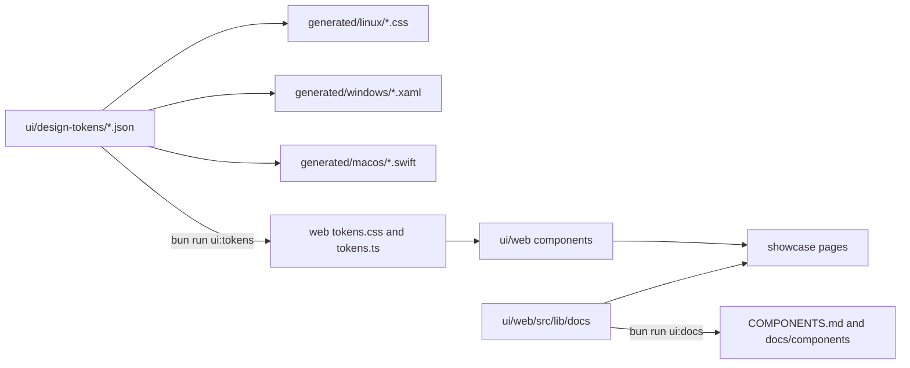

# UI Library

Git Manager has its own UI library and design system in `ui/`. The Svelte components in `ui/web/` copy the app's look exactly, and the design tokens in `ui/design-tokens/` describe colors, sizes and each component's measurements once, for every platform.

## Why we need it

- **One look everywhere.** The app is moving to native macOS, Windows and Linux apps later. When every platform builds its components from the same tokens, a change of a size or a color reaches all of them.
- **Faster work.** New screens are put together from ready components instead of new markup and CSS.
- **Usable by people and AI agents.** Every component has one doc. People read it in the showcase; agents read the same text as Markdown.

## How it is organized

- **Tokens.** `colors.json` holds the built-in Light and Dark colors (equal to `src/app.css` for now). `typography.json` holds the font families, sizes, weights, line heights, letter spacing and named text styles (body, label, hint, caption, sectionLabel, title, heading, code...). `tokens.json` holds size, radius, space, motion, the breakpoints (panel and window widths) and the grid. `components.json` and `components-2.json` (one file would pass 300 lines) hold each component's measurements, such as `"button": {"height": "{size.control}"}`. A string in braces refers to another token.
- **Generators.** `design-tokens/build/` turns the files into CSS variables (`--button-height`), a TypeScript object for code that measures in script, Swift (`GMColor.bg`, `GMButtonTokens.height`), XAML resource dictionaries and GTK 4 CSS. Swift output type-checks with `swiftc`.
- **Components.** `ui/web/src/lib/components/` has one component per file. Each reads its sizes from token variables and its colors from the theme. They take no `class` or `style`: tone, size and layout are props. `Stack` lays things out with spacing steps and `Text` writes words in a tone and size, so screens need no CSS of their own.
- **Named sizes.** Design props are never free numbers or text. Icon sizes and strokes, control, popover and dialog widths, view and row heights, text rows, panel sizes and spacing steps are named presets from `tokens.json` (`logic/presets.ts`), so every platform has the same few choices. Numbers are only for data, such as a count or a size the user dragged.
- **Editor surfaces.** `CodeEditor`, `DiffView`, `MergeView`, `MarkdownView`, `FormatToolbar`, `MediaView` and `TerminalView` wrap CodeMirror, markdown-it and xterm.js in the app's look, with colors from the theme tokens. The app adds its own features (blame, staging, a shell) through props such as `extensions` and `onready`. `AppShell` is the window layout: activity bars, resizable side and bottom panels, and the status bar.
- **Logic.** Keyboard movement, tree rows, virtual windows, menu placement, pick filtering and resizing live in `ui/web/src/lib/logic/` as pure TypeScript with tests.
- **Docs.** `ui/web/src/lib/docs/` has one doc per component: summary, when to use it, every prop, rules, examples and the app markup it replaces. `bun run ui:docs` writes `ui/web/COMPONENTS.md` (an index), `ui/web/docs/groups/<Group>.md` (a line per component) and `ui/web/docs/components/<Name>.md`.
- **Showcase.** `bun run ui` serves http://localhost:1430: a sidebar of components by group, a live preview, the props table, the rules, and code tabs for the example, the component, its logic and the Markdown doc. Foundations shows every color, text style, size, the grid and the breakpoints. A switch tries Light and Dark. `bun run ui:themes` opens every story in light and dark and fails on a page error or on text that does not stand out from what is behind it, which catches a color that does not follow the theme.

## The MCP server for AI agents

`ui/mcp/` lets AI agents ask the design system for components, tokens, icons and rules. See [UI-Library-MCP.md](UI-Library-MCP.md).

## Rules

- New UI is a library component first: component, doc, story and tokens, then the app uses it.
- Only reusable building blocks go in the library: primitives and variants or props on them. A screen-specific piece (a "Commit to" row), or one that only arranges other components with no behavior of its own (a copy field, a confirm dialog), is composed from them, not added as a component.
- No `class` or `style` props, no literal colors (the white switch knob is the only listed exception).
- No free numbers or text for design: sizes, widths, heights, gaps and paddings are named presets; there is no margin prop.
- Sizes come from token variables, never a pixel value copied into a component.
- Stories use only library components, no CSS, which proves a screen needs none.
- Every file stays within 120 columns and 300 lines; generated files are split by kind.

## Tests

- `design-tokens/build/tokens.test.ts`: colors and the popup shadow equal `src/app.css` in light and dark, every generated file is up to date and within the line limits, references resolve, and colors and shadows parse.
- `web/src/lib/docs/docs.test.ts`: every component has one doc and one story, each doc lists exactly the props in the component's `$props()` with the same defaults, bindables and required ones, no component takes a class or style, no literal colors, stories have no CSS, and the generated Markdown is fresh and within 120 columns.
- `web/src/lib/logic/*.test.ts`: the pure logic.
- `ui/lines.test.ts`: every file in `ui/` stays within 120 columns and 300 lines.
- `web/src/lib/styles/markdown.test.ts`: the Markdown styles stay equal to the app's preview.
- `bun run check` type-checks `ui/web` with its own tsconfig.

## Parity with the app

`bun run ui:parity` proves each component looks exactly like the app's own UI. Each case in `ui/web/src/parity/cases/` holds the app's markup, styled by the CSS read at test time from the app's real `.svelte` files and `app.css`. Svelte's scoping weight is kept, so rules compete as they do in the app. Next to it sits the library component in the same state. Elements that a child component draws, such as an icon, are marked so the app's scoped rules skip them, as Svelte's scoping does. A browser compares 36 computed properties (stroke width included) of each pair at rest, on hover and on focus, pseudo-elements included, in light and dark. Any difference fails. Known app bugs, where the library is right, are listed with their reason instead, such as the dialog's red confirm button turning blue on hover. Side-by-side screenshots land in `ui/web/.parity/`, which is not committed.

## Where the code lives

| Path | What it holds |
| --- | --- |
| `ui/design-tokens/*.json` | The design system's values |
| `ui/design-tokens/build/` | The model and one writer per platform |
| `ui/design-tokens/scripts/tokens.ts` | `bun run ui:tokens` (`--check` fails on stale files) |
| `ui/web/src/lib/components/` | The Svelte components |
| `ui/web/src/lib/docs/` | One doc per component and the Markdown writer |
| `ui/web/src/showcase/` | The local site, stories and foundation pages |
| `ui/web/scripts/docs.ts` | `bun run ui:docs` (`--check` fails on stale pages) |

## Bugs we fixed

- **Select's arrow touched the right border.** WebKit draws a native select's arrow against the border and ignores the padding. Select now hides the native arrow (`appearance: none`) and draws a chevron inside the padding, using the `select` tokens for its inset and room, so every platform gets the same numbers. The app's selects do the same in `src/app.css` (`select.input`, a chevron of two gradient strokes in `--text-dim`, so it follows every theme); the 24 px ones set `--select-arrow-inset: 6px`.

## Keeping this page in sync

- Update it when the token files, the generators, the rules or the scripts change.
- Add a parity case (`ui/web/src/parity/cases/`) for every new component that has an app counterpart.
