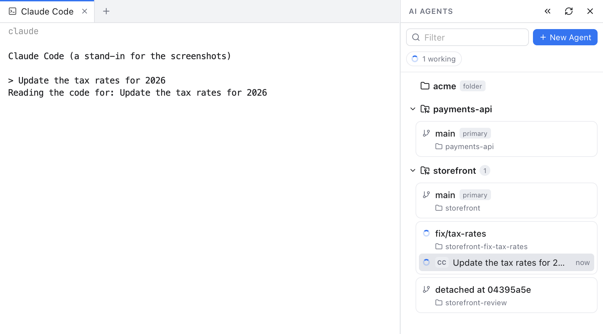
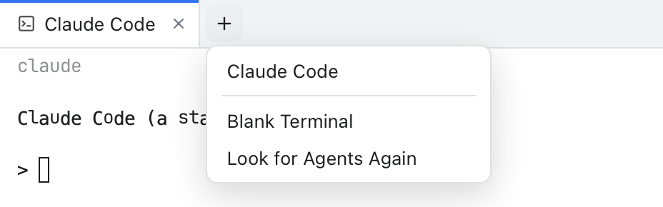
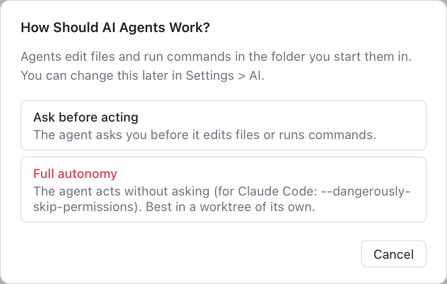
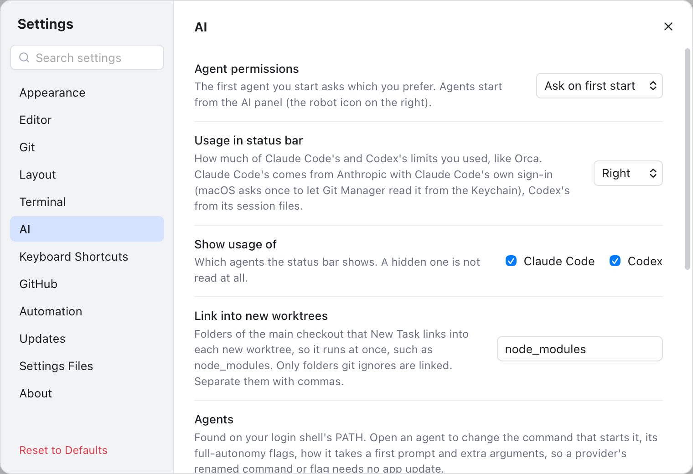
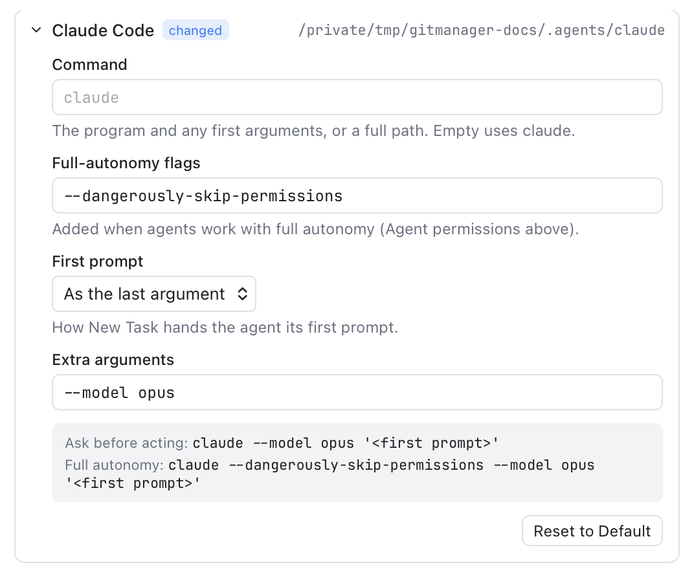

# AI Agents

The AI panel runs AI coding agents, such as Claude Code or Codex, next to your code, like [Orca](https://github.com/stablyai/orca). Each project of your workspace is listed with its worktrees, and each worktree with the agents working in it. An agent runs in its own editor tab, and the panel shows what it is doing.

*The AI panel: storefront has a worktree for a fix, and Claude Code is working in it.*

## Open the panel

Click the **robot** button in the right activity bar, under the Files button, or choose **View > AI Agents**. The panel opens on the right, in place of the Files panel. Click the button again, or the **X** in the panel, to hide it. Click the Files button to go back to the file tree.

## Projects and worktrees

Like in Orca, every folder of your workspace is a **project**, marked **folder**, and so is every repository found in it. Start an agent in a folder project to work in that folder, git or not; agents in its subfolders are listed under it too. A workspace folder that is a repository itself is listed once, as the repository.

Under each repository the panel shows a **card** for each of its **worktrees**. A worktree is an extra checkout of the same repository in its own folder, with its own branch (see [Worktrees](Worktrees.md)). Agents in different worktrees never touch each other's files, so you can let several agents work at once, each on its own task.

A card shows the branch on top and the folder below it, then the agents working there. The repository's own folder is marked **primary**; a worktree whose folder is gone is marked **missing**. Hover a card for its **+** (start an agent) and **...** (more actions) buttons.

Type in **Filter** to find a worktree or agent by its branch, folder, name or task. Click a project's name to fold it.

If your workspace opened a worktree as a folder of its own, it is still listed once, under its repository.

## Start an agent

- Hover a worktree and click **+**, then pick an agent. The agent starts in that worktree.
- Click **New Agent** at the top of the panel, or choose **View > New AI Agent...**, to start one in the active repository.
- Right-click a project or worktree and choose **Start Agent**.

The menu lists the agents installed on your Mac: Claude Code, Codex, Gemini CLI, OpenCode, Cursor CLI, GitHub Copilot CLI, Aider, Amp and Qwen Code. Git Manager looks for them where your terminal does, on your login shell's PATH. **Blank Terminal** opens a plain terminal in the same folder. If you install an agent while the app runs, click **Refresh** in the panel.

The agent opens in a new editor tab, like a terminal tab. Above its output, a dimmed line shows the command that started it. Type to it as you would in a terminal.

*The + after an agent's tab starts another agent or a terminal in the same worktree.*

While an agent's tab is shown, a **+** follows the tabs, like in Orca. Click it to start another agent, or a **Blank Terminal**, in the same worktree; the new tab opens in the same editor group.

### A new task on its own branch

Click **+** next to a repository for **New Task**: a task name becomes a branch and a worktree with an agent in it, and several agents can race on the same task. See [AI Tasks](AI-Tasks.md). For full control, right-click the repository and choose **New Worktree...**: pick a branch and a folder as in [Worktrees](Worktrees.md), and **Then start** an agent.

## What the agents are doing

Each agent row shows its state, a short mark for the agent (**CC** for Claude Code, **Cx** for Codex...), what it is working on (when the agent says so) and how long ago its state changed (**now**, **4m**, **2h**):

| Mark | State | Meaning |
| --- | --- | --- |
| Spinner | Starting, Working | The agent starts or works on a request. |
| Orange **?** | Needs you | It asks a question or needs your permission. |
| Green check | Done | It finished and waits for the next request. |
| Empty ring | Ready | It waits for your first request. |
| Square | Exited | The agent closed. |

A card takes the mark of its most urgent agent. Above the list, **1 needs you** and **2 working** count the agents; click **needs you** to jump to the agent that is waiting.

Agents show their state in the terminal title, and the panel reads it from there. When an agent in a hidden tab finishes or needs you, its tab gets a dot, and so does the robot button while the AI panel is hidden.

Click an agent row to show its tab. Right-click it for **Restart Agent**, **Stop Agent**, **Rename...** and **Close Agent Tab**. When an agent exits, its tab stays with the last output and a **Restart** button.

## Permissions

*The first agent you start asks how agents should work.*

The first time you start an agent, Git Manager asks how agents should work:

- **Ask before acting**: the agent asks you before it edits files or runs commands.
- **Full autonomy**: the agent acts without asking. Git Manager adds the agent's own flag for this, for example `--dangerously-skip-permissions` for Claude Code. This is safest in a worktree of its own.

Your answer is remembered. Change it any time in **Settings > AI**.

## Settings

*Settings > AI: the permission mode and every agent, found or not.*

**Settings > AI** has:

- **Agent permissions**: **Ask on first start** (the default), **Ask before acting** or **Full autonomy**.
- **Usage in status bar**: see [AI Usage](AI-Usage.md).
- **Link into new worktrees**: see [AI Tasks](AI-Tasks.md#ready-to-run).
- **Agents**: each agent with where it was found. **Look Again** searches the PATH again.

### Change how an agent starts

*Claude Code's command, flags and first prompt, with a preview of what runs.*

Click an agent in **Settings > AI > Agents** to change what starts it. If a provider renames its command or a flag, change it here; no app update needed.

- **Command**: the program and any first arguments, such as `claude`, `npx -y @openai/codex` or a full path. Empty uses the default.
- **Full-autonomy flags**: added in full-autonomy mode, such as `--dangerously-skip-permissions`. Empty the field for none.
- **First prompt**: how [New Task](AI-Tasks.md) hands the agent its prompt: as the last argument, after a flag you type, typed into it once it starts, or not at all.
- **Extra arguments**: added each time it starts, such as `--model opus`.

The gray box shows the command each permission mode runs. **Reset to Default** undoes your changes.

## Good to know

- Agents run with your own account and settings, exactly as in a terminal. Git Manager never sends anything to them by itself.
- Agent tabs are not reopened after you quit the app; your worktrees stay.
- [Clear Cache](Clear-Cache.md) keeps agents running, like terminals.
- Closing an agent's tab stops the agent. Removing a worktree from the panel (right-click, **Remove Worktree...**) closes the agents in it first.

## Related

- [Worktrees](Worktrees.md)
- [Terminal](Terminal.md)
- [MCP and CLI](MCP-and-CLI.md): AI tools can also drive Git Manager itself.
