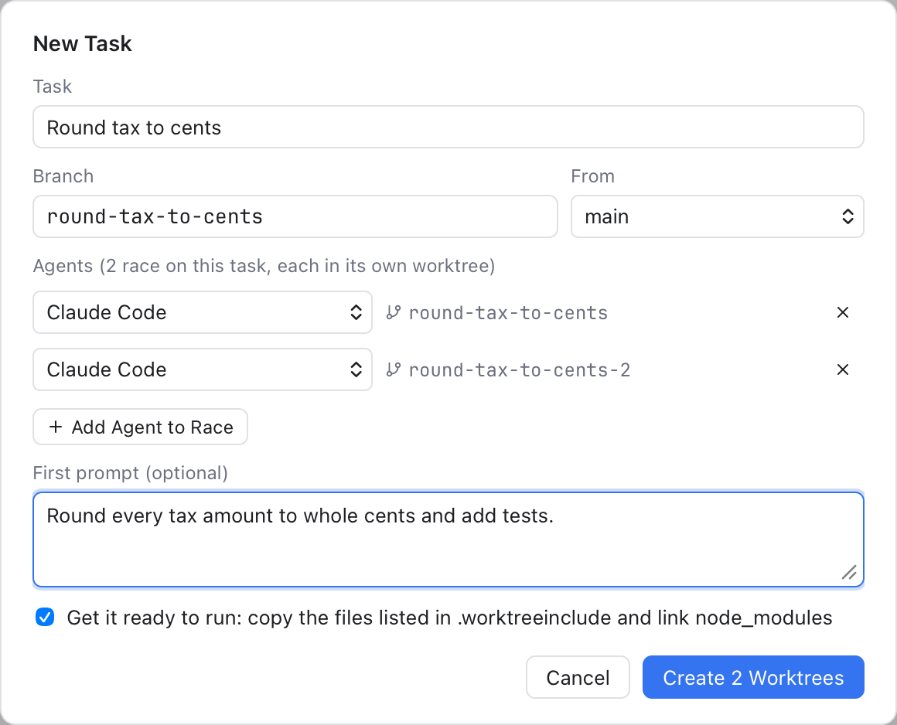

# AI Tasks: Several Branches at Once

Work on the same project on several branches at the same time, like in [Orca](https://github.com/stablyai/orca). Each **task** gets its own branch in its own folder (a git **worktree**, see [Worktrees](Worktrees.md)), with an AI agent working in it. Agents in different worktrees never touch each other's files, so one can fix a bug while another builds a feature, and you can let several agents race on the same task and keep the best result.



*New Task: two agents race on one task, each in its own worktree, with the same first prompt.*

## Start a task

In the [AI panel](AI-Agents.md), hover a repository and click **+**, or choose **View > New AI Task...** for the active repository. Then:

1. **Task**: say what the task is, for example "Fix the login race". The branch name follows it (`fix-the-login-race`); change it if you like.
2. **From**: the branch the task starts from. It is your project's main branch on the remote (what `origin/HEAD` points to), else the branch you are on.
3. **Agent**: the agent that works on it, preset to the one you used last. Pick **No agent** for just the worktree.
4. **First prompt** (optional): what the agent should do. It is sent to the agent as it starts, so it gets to work at once.
5. Click **Create Task** (or press Cmd+Enter).

The worktree is made next to the repository's folder, named after it and the branch (`storefront-fix-the-login-race`). Its card appears in the AI panel with the agent working in it. If the branch name is taken, the next free one is used (`fix-the-login-race-2`) and the dialog says so.

## Race several agents

Click **Add Agent to Race** to add up to five agents. Each one gets its own worktree and branch (`fix-the-login-race`, `fix-the-login-race-2`...), all from the same starting point, with the same first prompt. Pick a different agent for each, or the same one several times. When they are done, compare their changes and keep the best one; finish the others.

## Ready to run

A new worktree is a clean checkout: files git ignores, such as `.env` or downloaded packages, are not in it. With **Get it ready to run** checked (the default), Git Manager:

- copies the files and folders listed in a `.worktreeinclude` file at the top of your repository, one path per line (lines starting with `#` are notes; patterns such as `*.env` are not supported);
- links the folders set in **Settings > AI > Link into new worktrees** (`node_modules` by default), so packages are not installed again.

Only paths git ignores are copied or linked, and nothing already in the worktree is replaced. The message after creating says what was copied and linked, and what was skipped and why. A linked folder is added to the repository's `.git/info/exclude`, so the worktree never shows it as a change.

```text
# .worktreeinclude
.env
.env.local
config/local.json
```

## Finish a task

Right-click a worktree's card (or use its **...** button) and choose **Finish Task...**. Git Manager asks first, then:

1. closes the agents working in it,
2. removes the worktree's folder,
3. deletes its branch.

If the worktree has uncommitted changes, the question says they will be lost. If the branch has commits that are not merged anywhere, Git Manager asks again before deleting it; choose **Keep Branch** to keep it. **Remove Worktree...** removes only the folder and keeps the branch.

## Related

- [AI Agents](AI-Agents.md): the AI panel and the agents.
- [Worktrees](Worktrees.md): worktrees in the Branches sidebar.
