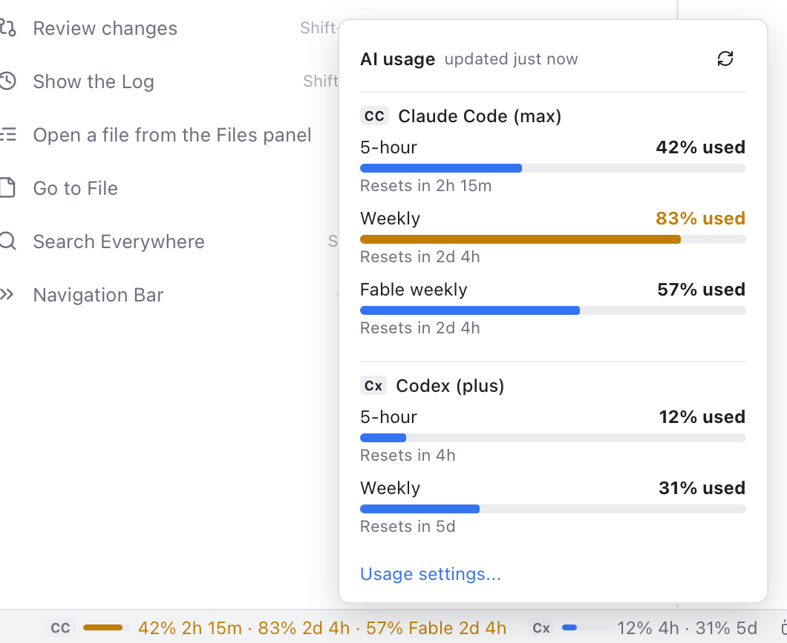

# AI Usage in the Status Bar

See how much of your AI plan's limits you have used: Claude Code's and Codex's 5-hour and weekly limits, right in the status bar. You know before an agent stops halfway through a task.

*Claude Code is past 80% of its weekly limit, so its numbers turn orange; Codex has plenty left.*

## What it shows

For each agent you use, a short mark (**CC** for Claude Code, **Cx** for Codex), a small bar and the numbers:

`42% 2h 15m · 83% 2d 4h`

means 42% of the 5-hour limit is used and it resets in 2 hours 15 minutes, and 83% of the weekly limit is used and it resets in 2 days 4 hours. The times count down as you watch. When Claude Code's plan also has a weekly limit for one model, such as Fable, it follows with its name: `· 57% Fable 2d 4h`. The bar shows the fullest limit; hover for each limit's name. From 80% the numbers turn orange, from 95% red.

Click it for the details: each limit with a bar and when it resets ("Resets in 2h 15m"), the plan (such as **max** or **plus**), and **Refresh**. **Usage settings...** opens Settings.

If an agent shows **signed out**, start it once in a terminal so it signs in again. **no data** means the agent has not recorded any usage yet (Codex records it after its first answer).

## Where it shows

**Settings > AI > Usage in status bar**: **Right** (the default, next to the notifications), **Left** (after the repository and branch) or **Hidden**. Hidden reads nothing at all.

**Settings > AI > Show usage of** has a box per agent, **Claude Code** and **Codex**, both on by default. Turn one off to leave it out of the status bar; its usage is then not read at all (for Claude Code: no Keychain and no request to Anthropic).

## Where the numbers come from

- **Claude Code**: Git Manager asks Anthropic, with the sign-in Claude Code itself keeps in your macOS Keychain. The first time, macOS asks whether Git Manager may use "Claude Code-credentials"; choose **Always Allow** so it does not ask again. The sign-in is read only to ask for the numbers: it is never saved by Git Manager and never sent anywhere but `api.anthropic.com`. If you say no, Git Manager does not ask again until you click **Refresh**.
- **Codex**: Git Manager reads the limits Codex writes into its own session files in `~/.codex`. Nothing is sent anywhere.

The numbers are read every 5 minutes while the window is open, a little after an agent finishes, and when you click Refresh. Only agents set up on this Mac are shown (their `~/.claude` or `~/.codex` folder exists).

## Related

- [AI Agents](AI-Agents.md)
- [Status Bar and Help](Status-Bar-and-Help.md)
