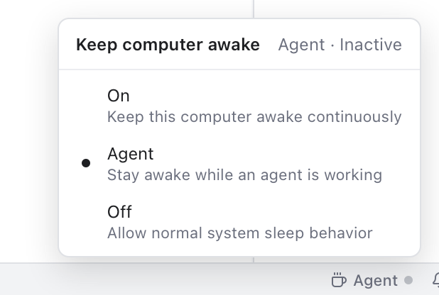

# Keep Computer Awake

Stop your computer from sleeping, turning off its screen or locking while AI agents work. A long agent run then finishes even when you walk away.

*The coffee cup in the status bar and its menu: Agent mode keeps the computer awake only while an agent works.*

## The three modes

Click the **coffee cup** at the right of the status bar, or open **Settings > AI > Keep computer awake**:

| Mode | What it does |
| --- | --- |
| **On** | Keep this computer awake continuously. |
| **Agent** | Stay awake while an agent is working. |
| **Off** | Allow normal system sleep behavior. This is the default. |

While the computer is held awake, the screen stays on, it does not lock after you stop using it, and the computer does not go to sleep.

In **Agent** mode it is held awake while any agent in the [AI panel](AI-Agents.md) is starting or working. When the agents finish, or wait for your answer, the computer may sleep again as usual.

The status bar shows the mode and a dot: a filled dot while the computer is held awake (**Active**), a faint one otherwise (**Inactive**). Hover it to read the status; the menu shows it at the top, such as **Agent · Active**.

## Good to know

- **Mac laptops**: closing the lid still puts the Mac to sleep. Keep the lid open for long runs.
- **Windows**: what closing the lid does follows the computer's power settings.
- **Linux**: Git Manager asks `systemd-inhibit` to stop idle sleep.
- Several windows share it: the computer stays awake while any of them asks.
- If Git Manager quits or crashes, the computer goes back to normal at once.

## Related

- [AI Agents](AI-Agents.md)
- [AI Usage](AI-Usage.md)
