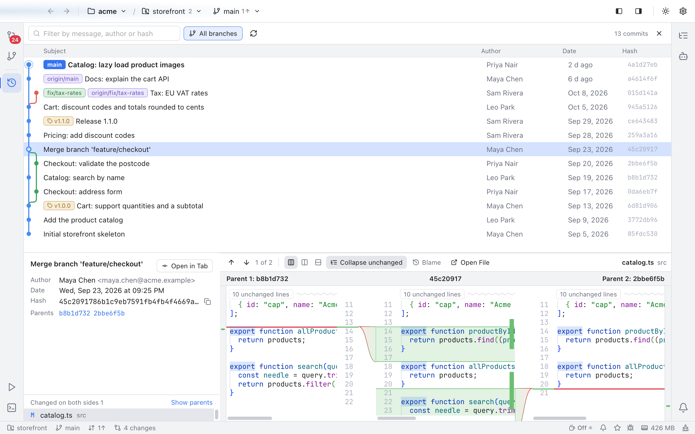

# Merge Commits

A merge commit joins two branches, so it has two parents: the branch you merged into (parent 1) and the branch you merged (parent 2). The [Log](History-and-Log.md) shows a merge the way JetBrains IDEs do, so you can see which files the merge had to put together.

*A merge commit's file changed on both sides, in three panes: parent 1, the merge result and parent 2.*

## Changed on both sides

Select a merge in the Log. Under its details, **Changed on both sides** lists only the files that differ from every parent. These are the files the merge combined: both branches changed them, so git merged their lines, or there was a conflict and someone resolved it by hand. A merge with a conflict usually says so in its message too, under `# Conflicts:`.

Files that came whole from one branch are not listed, since the merge did nothing to them. If no file changed on both sides, the list says **No files changed on both sides** and offers **Show changes to parents**.

Click a file to see it in three panes, like PhpStorm: **Parent 1** on the left, the merge result in the middle and **Parent 2** on the right. Colored bands join each parent's changes to the result's lines. Like VS Code, a change is red in the parent (the older side) and green in the result (the newer side). Lines both parents changed are red, a conflict the merge resolved. The toolbar counts them, such as **2 changes, 1 conflict**, and its arrows (or F7 and Shift+F7) step through them. Scroll any pane and the others follow, so matching lines stay level. **Collapse unchanged** folds the lines that match both parents in all three panes at once.

The layout buttons in the toolbar switch between **Three panes**, **Side by side** and **Inline**. The last two show the usual diff against **Parent 1**, with a **Three panes** button to come back. Git Manager remembers your choice, and **Side by side for commits** in Settings > Git (**2 columns** or **3 columns**) sets it too. **Blame** shows who wrote each line of the merge result, and **Open File** opens the file as it is in your working tree. A binary file, or one too large to diff, always shows the diff against **Parent 1**.

## Changes to parents

Click **Show parents** at the top right of the list (or **Show changes to parents** when the list is empty) to see everything the merge changed, in one group per parent:

- **Changes to parent 1**: what the merge brought into your branch. This is what most tools show for a merge.
- **Changes to parent 2**: what the merge changed compared with the merged branch.

A file can be in both groups. Its diff is labelled **Parent 1** or **Parent 2**, so you always know which side you compare with. Click **Show both sides** to go back. The Log keeps your choice while you move between commits.

## Why a file might be listed without a conflict

Git does not record conflicts in the history. When both branches change the same file in different places, git merges it on its own, and the file still differs from both parents. So the list shows every file the merge combined, a superset of the files that had a conflict. This is the same list as `git diff-tree -c --name-only <merge>`, and as PhpStorm's view of a merge.

## Related

- [History and Log](History-and-Log.md)
- [Resolving conflicts](Resolving-Conflicts.md)
- [How merge commits work](../developer/How-Merge-Commits-Work.md)
