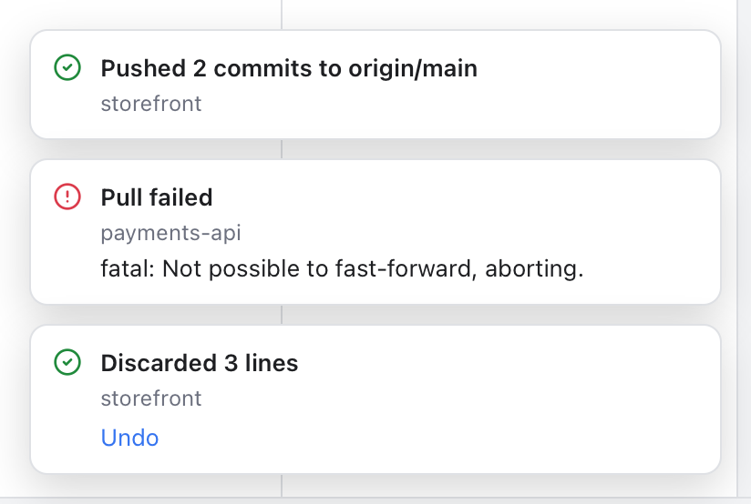
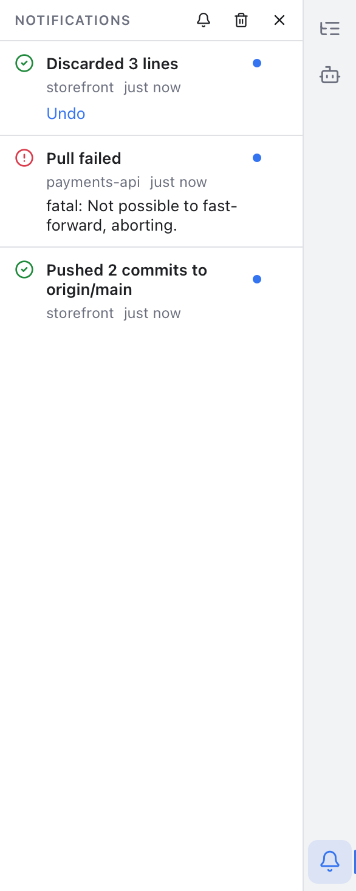

# Notifications

Git Manager tells you when something happens: a push went through, a pull failed, a fetch found new commits, a stash was saved. Each message pops up for a moment in the bottom right corner, like the balloons in PhpStorm. Every message is also kept in the Notifications panel, so you can read it later even if you missed it.

## Pop-up messages

*A push that went through, a pull that failed with git's message, and a discard with its Undo link.*

Each balloon shows:

- An icon for the kind: a blue **i** for information, a green check when something is done, a yellow triangle for a warning, and a red mark for an error.
- A short title, such as **Pull failed**.
- The repository it came from, when your workspace has more than one repository.
- More text when there is some, such as git's own error message. You can select and copy it.
- A link when there is something to do next, such as **Undo**.

Balloons close on their own after a few seconds. Errors stay longest, so there is time to read them. While your pointer is over a balloon it stays open, and it closes a moment after you move away. The **x** in its corner (it shows when you point at the balloon) closes it right away.

At most four balloons show at once. When more arrive, the oldest close early, but they are all still in the panel.

## The Notifications panel

*The Notifications panel lists this session's messages, newest first. The dot marks the ones you had not seen.*

Open it with the **bell** at the bottom of the right activity bar (the strip of icons on the right edge of the window). The bell in the status bar and **View > Notifications** open it too. Click the bell again to hide the panel.

The panel lists every message of this session, newest first:

- Each message shows its kind, title, repository, how long ago it came and any extra text.
- A dot marks messages that arrived since you last looked.
- A link such as **Undo** stays for a while after the message came. It goes away once it has been used or what it acts on has changed.
- Point at a message and click its **x** to clear just that one.
- The **trash can** at the top clears them all.

While the panel is open, messages go straight into the list and no balloons pop up, because you can already see them.

The list starts empty each time you open Git Manager. It keeps up to 200 messages.

## The count on the bell

When errors or warnings arrive that you have not seen, the bell shows how many. The count is red if one of them is an error, and amber for warnings only. Opening the panel marks everything as seen and clears the count.

## Do Not Disturb

Turn on **Do Not Disturb** with the bell button at the top of the panel, or with **View > Do Not Disturb**. Only errors pop up then. Everything else still goes into the panel, so nothing is lost. The bells show a crossed-out bell while it is on.

## Related

- [Status Bar and Help](Status-Bar-and-Help.md): the other items in the status bar.
- [Repository Actions](Repository-Actions.md): Pull, Push, Sync and Fetch, which report here.
- Developer chapter: [How notifications work](../developer/How-Notifications-Work.md).
