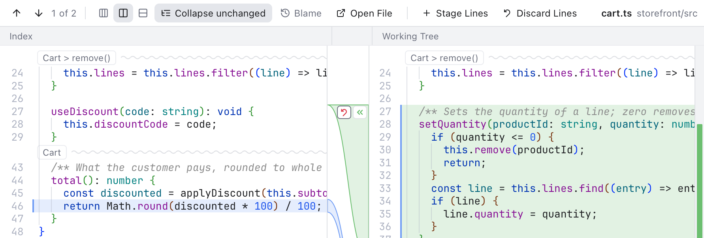
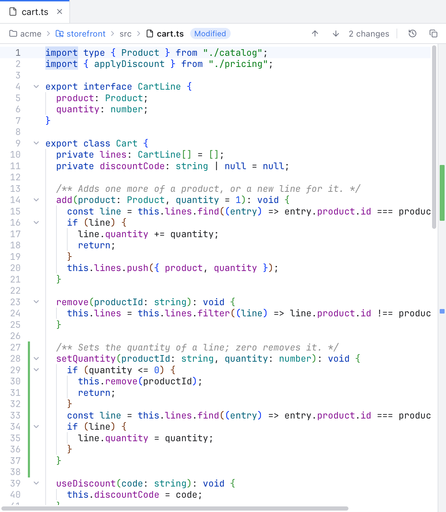

# Revert a Change

Sometimes you want to throw away one change in a file and keep the rest. Revert does that for a single change, like Rollback in PhpStorm or Revert Change in GitLens. A "change" (git calls it a hunk) is one block of lines that differ, with unchanged lines around it.

You can revert in two places: in the Changes diff, and in the file editor.

## In the Changes diff

*The first change of cart.ts with its Revert button (under the pointer) and its Stage arrow on its band.*

Select a file under **Changes** to open its diff. Each change has two buttons:

- **«**, **Stage this change**, copies the change into the index (the staging area, what the next commit will hold).
- The curved arrow next to it, **Revert this change**, puts the staged version of those lines back in your working tree file.

In the inline layout, the same two buttons sit on the first line of each change: **+** to stage and the curved arrow to revert.

Revert always asks first. When you confirm, the file on disk changes and the diff reloads. A message says how many lines were discarded, with an **Undo** button that puts your lines back.

Revert is only offered for **Changes** (the working tree against the index). A diff from **Staged** has **Unstage this change** instead, and diffs of commits are read-only.

If the file changed after the diff was shown, for example in another editor, nothing is reverted: a message asks you to check the diff and try again, so you never lose lines you have not seen.

## In the file editor

*Added lines in cart.ts with their green bar beside the line numbers: click it to revert them.*

While you edit, colored bars beside the line numbers show what changed since the last commit (see [Editor and Tabs](Editor-and-Tabs.md#change-markers)). The pointer turns into a hand over a bar. Click it to revert that change:

- For added or modified lines, click the bar beside them.
- For deleted lines, click the small red wedge where they were.

After you confirm, the last commit's lines replace the change in the editor. This is an ordinary edit, the same as typing:

- **Edit > Undo** brings your lines back.
- Nothing is saved until you save the file, or until auto save does.

Conflict blocks have their own bar and are not reverted this way; use the conflict actions instead (see [Resolving Conflicts](Resolving-Conflicts.md)).

## Which version comes back

The two places compare with different versions, the same ones their colors show:

- The Changes diff compares the working tree with the index, so Revert brings back the **staged** lines. If you never staged the file, that is the last commit.
- The editor compares your text with the **last commit** (HEAD), so Revert brings back the committed lines, even when a newer version is staged.

## Related

- [Diffs](Diffs.md)
- [Inline Diffs](Inline-Diffs.md)
- [Editor and Tabs](Editor-and-Tabs.md)
- [How reverting a change works (developer)](../developer/How-Reverting-a-Change-Works.md)
