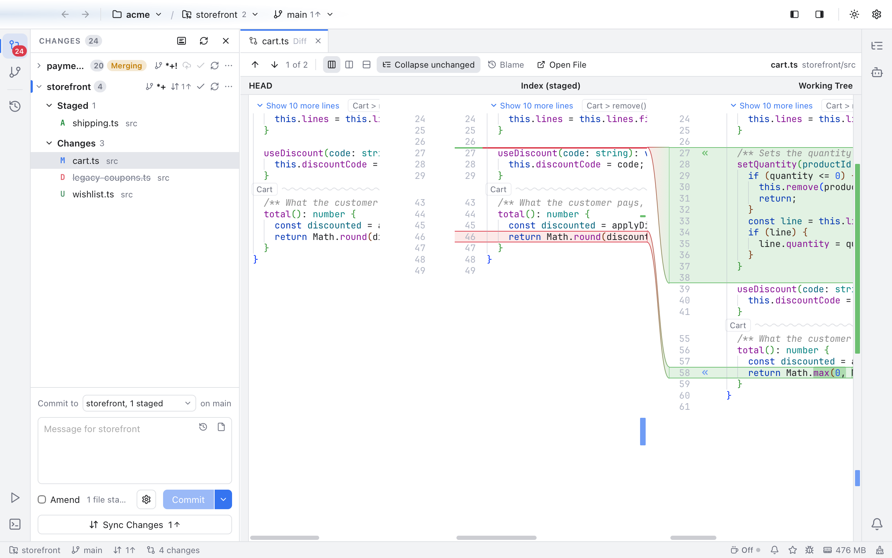

# Staging View

The staging view shows a changed file in three panes, like PhpStorm: **HEAD** (the last commit) on the left, the **Index (staged)** in the middle and the **Working Tree** (the file on disk) on the right. You see at a glance what is already staged for the next commit and what is not, and you stage or unstage single changes from the bands between the panes.

*cart.ts in the staging view: nothing is staged yet, so every change sits between the index and the working tree, each with a stage button.*

## Turn it on

Open a file from [Changes](Changes-and-Commits.md), or from the Changes tab that **N changes** in the status bar opens, then click the **Three panes** button among the layout buttons of the diff toolbar. Both places share the setting. Click **Side by side** or **Inline** to go back to the usual two-pane diff. Nibtree remembers your choice for the next file. You can also pick it in Settings > Git: **Side by side in Changes** is **2 columns** or **3 columns**.

The staging view is offered for files that are modified, in the index, the working tree or both. New, deleted, renamed, conflicted and binary files keep the two-pane diff.

## Read it

- The bands on the **left** join HEAD to the index: the changes you have staged.
- The bands on the **right** join the index to the working tree: the changes you have not staged yet.
- Like VS Code, each change is red on its older side and green on its newer side: a staged change is red in HEAD and green in the index, and an unstaged change red in the index and green in the working tree.

The toolbar is the same as in every diff. **Blame** shows who wrote each line of the working tree pane.

To make a pane wider, drag the edge of a column of bands, like the line between the sides of a [diff](Diffs.md#resize-the-two-sides). Scroll any pane and the others follow, so matching lines stay level. **Collapse unchanged** folds the lines that are the same in all three panes, with the wavy fold bars of the [Diffs](Diffs.md) view. **Open File** opens the file itself in an editor tab, at the line you were looking at in the working tree.

## Stage and unstage

- **«** on a right band, **Stage this change**, copies that change from the working tree into the index.
- **»** on a left band, **Unstage this change**, puts HEAD's lines back into the index.

The panes update after each click, and the lists in Changes follow.

## Related

- [Diffs](Diffs.md)
- [Changes and Commits](Changes-and-Commits.md)
- [How the staging view works](../developer/How-the-Staging-View-Works.md)
